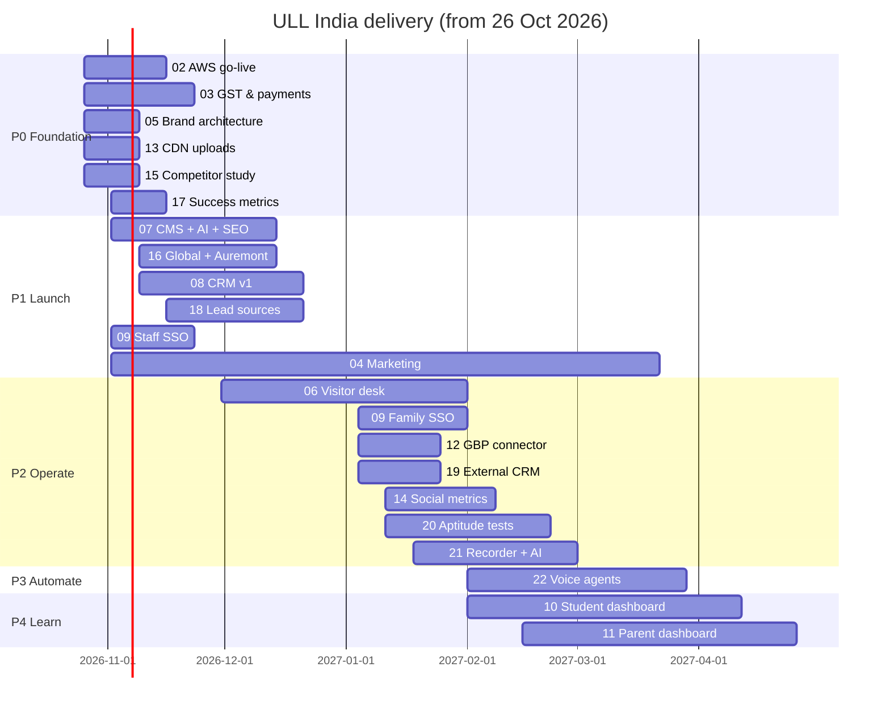

# 01 · Timeline for each workstream

## Assumptions

- **Start:** Monday 26 Oct 2026. Dates are week-start Mondays.
- **Team:** 2 full-stack developers, 1 designer (part-time), 1 content lead + AI tools, 1 digital marketer, 1 social/video person, ground sales at Nagarbhavi. If the team is smaller, phases 3–4 slip and phases 1–2 stay.
- **Season:** 2027-28 admissions are already open across competitors (VIBGYOR's form defaults to 2027-28, Orchids advertises "Admissions 2027-28"). The site, lead capture and CRM must be live **before mid-December**, because Nov–Feb is when most families shortlist schools.
- **Holidays:** Diwali falls around 8 Nov 2026 (expect a slow week), Christmas/New Year (21 Dec–1 Jan, reduced team).
- **What exists today:** UAT and prod CDK stacks, a static Next.js site with a page builder, Payload CMS with Pages, Media, Enquiries and Users, roles, SES/Gupshup/WATI notification adapter, and versioned CDN uploads (uncommitted on `main`).

## Phases

| Phase | Window | Goal |
|---|---|---|
| **P0 Foundation** | 26 Oct – 13 Nov | Prod live on `ullindia.com`, legal and company details settled, competitor study done, metrics agreed |
| **P1 Launch** | 9 Nov – 18 Dec | Umbrella site with Auremont + Global sections, AI-assisted CMS, CRM v1 with source tracking, marketing live |
| **P2 Operate** | 4 Jan – 26 Feb | Visitor desk at Nagarbhavi, external CRM sync, GBP connector, social dashboard, family SSO, aptitude tests, recorder pilot |
| **P3 Automate** | 1 Feb – 26 Mar | Voice agents, AI follow-ups, conversation analytics at scale |
| **P4 Learn** | 1 Feb – 30 Apr | Student and parent dashboards, ready for the 2027-28 academic year |

## Calendar by workstream

| # | Workstream | Start | End | Depends on | Milestone |
|---|---|---|---|---|---|
| 02 | AWS deployment (infra, CDK, domain, DNS, SSL, CDN, backups) | 26 Oct | 13 Nov | AWS account (done) | `ullindia.com` served from prod, restore drill passed |
| 03 | GST, company profile, payment details | 26 Oct | 20 Nov | Company documents from finance | Legal footer live, gateway KYC submitted |
| 04 | Marketing (online + offline) | 2 Nov | ongoing | 05, 15, 17 | Campaigns live 14 Dec, campus walkthrough video by 11 Dec |
| 05 | Brand architecture (ULL India → ULL Global, ULL Auremont) | 26 Oct | 6 Nov | Brand assets | Naming, URL map and logo rules signed off |
| 06 | Visitor management + operational intelligence | 30 Nov | 29 Jan | 08, 09 | Gate QR + OTP pilot at Nagarbhavi 18 Jan |
| 07 | Website CMS with AI content + SEO validation | 2 Nov | 11 Dec | 13 | Content team publishes without developers |
| 08 | In-house CRM at `/admin` | 9 Nov | 18 Dec | 09 (staff SSO optional for v1) | Pipeline board live at site launch |
| 09 | SSO: staff (Entra ID) + parent/student | 2 Nov (staff) / 4 Jan (families) | 20 Nov / 29 Jan | Microsoft 365 tenant admin | Staff sign in with Microsoft by 20 Nov |
| 10 | Student dashboard | 1 Feb | 9 Apr | 09, 20, school ERP data | Beta for one grade band 9 Apr |
| 11 | Parent dashboard | 15 Feb | 23 Apr | 10 | First weekly report sent 23 Apr |
| 12 | Google Business Profile connector | 4 Jan | 22 Jan | GBP API approval (apply in week 1) | Reviews and posts managed from `/admin` |
| 13 | CDN for all uploads | 26 Oct | 6 Nov | 02 | Every upload and site asset served from `cdn.ullindia.com` |
| 14 | Social media metrics for group admin | 11 Jan | 5 Feb | Meta, YouTube, LinkedIn access | Weekly dashboard in `/admin` |
| 15 | Competitor deep study + gap report | 26 Oct | 6 Nov | none | Gap report and must-have list signed off |
| 16 | Dedicated pages for ULL Global and ULL Auremont | 9 Nov | 11 Dec | 05, 07, 15, content from school | Both sections live 14 Dec |
| 17 | Success metrics for each team | 2 Nov | 13 Nov | 15 | Targets agreed; dashboard from 14 Dec |
| 18 | CRM lead source attribution (online, offline, coupon, WhatsApp) | 16 Nov | 18 Dec | 08 | Every lead has a source at launch |
| 19 | External CRM sync (Orggen / Zoho) | 4 Jan | 22 Jan | 08, 18, vendor API docs | Leads mirrored within 1 minute |
| 20 | `ullindia.aptitudetest.in` psychometric integration | 11 Jan | 19 Feb | 09, integration docs | Test status and reports in both dashboards |
| 21 | Audio recorder devices + AI success metrics | 18 Jan | 26 Feb | 06, 08, device purchase | Scorecards for 4 personas |
| 22 | Sarvam AI voice agents (inbound + outbound) | 1 Feb | 26 Mar | 08, 19, telecom DLT | Fee reminders and inbound desk live |

## Gantt

## Critical path

`02 → 13 → 07 → 16 → launch 14 Dec`. The CRM (08 + 18) must be ready the same day, because ads (04) start driving leads at launch. Anything in P2–P4 can move without affecting the season.

## Things to start in week 1, because other people take time

- Google Business Profile API access request (approval can take weeks).
- Meta Business Manager verification and WhatsApp Business (WATI) template approval.
- DLT registration for SMS and voice (TRAI) under the company entity; needed before 06, 22.
- Microsoft Entra ID app registration by the tenant admin (09).
- Brainwonders / aptitudetest.in integration docs and subdomain setup (20).
- Orggen / Zoho API credentials and field list (19).
- Sarvam AI account, telephony partner and pricing (22).

## Risks

| Risk | Impact | Mitigation |
|---|---|---|
| School content (photos, fees, facilities, faculty) arrives late | 16 slips past the launch | Launch with what we have; mark pages "coming soon" rather than delay the site |
| ULL Global has no campus yet | Thin pages, weak SEO | Position as "launching" with an interest/waitlist form (plan 05/16) |
| Vendor approvals (GBP, Meta, DLT) | 12, 14, 22 slip | Apply in week 1; build against sandbox/dry-run modes |
| Recording and enrichment consent (DPDP Act) | Legal exposure | Consent screens and retention rules designed in 06/21 before any pilot |
| One EC2 per stage grows into CRM + jobs | Performance | Plan 02 adds a job queue and an RDS path before P2 |
