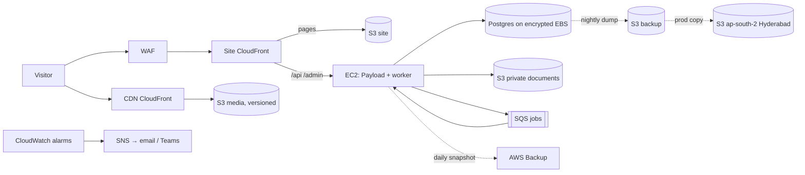

# 02 · AWS deployment

## What already exists (in `infra/`)

| Stack | Region | Contents |
|---|---|---|
| `UllShared` | ap-south-1 | Route 53 public zone `ullindia.com`, GitHub OIDC provider |
| `UllUat` / `UllProd` | ap-south-1 | Site bucket, versioned media bucket, backup bucket (30-day expiry), ECR repo, Secrets Manager (Payload, Postgres, hook), EC2 t3.medium with Elastic IP and SSM, site CloudFront (S3 + `/api` `/admin` to EC2), CDN CloudFront (immutable, 1 year), Route 53 A/AAAA, GitHub deploy role |
| `UllUatCert` / `UllProdCert` | us-east-1 | ACM certificate, created only with `-c attachDomains=true` |

Deploys: `.github/workflows/deploy.yml` on push to `uat` / `prod`, assuming `ull-<stage>-github`. Local commands use profile `ull-aws-cursor-vaibhav`.

Hostnames: `uat.ullindia.com`, `cdn-uat.ullindia.com`, `ullindia.com`, `www.ullindia.com`, `cdn.ullindia.com`.

## Target picture (after this plan)

## 1. Domain and DNS

1. Find out where `ullindia.com` is registered and who controls it (GoDaddy, Hostinger etc.). Record it in the runbook.
2. **Recommended:** delegate the whole domain to Route 53 (copy the four `NameServers` from the `UllShared` output to the registrar). CDK then owns every record.
3. **If email (Google Workspace / Microsoft 365) already runs on the domain**, copy its MX, SPF, DKIM, autodiscover and verification TXT records into the Route 53 zone **before** switching nameservers. Add them to `shared-stack.ts` so they are in code.
4. Lower the TTL at the old provider to 300s two days before the switch.
5. Future subdomains reserved now (plan 05): `auremont.ullindia.com` and `global.ullindia.com` as 301 redirects to `/auremont` and `/global`; `portal.ullindia.com` optional; `ullindia.aptitudetest.in` is owned by aptitudetest.in, not us (plan 20).

## 2. SSL

- ACM certificate in us-east-1 per stage (already coded). Add the redirect hostnames (`auremont.ullindia.com`, `global.ullindia.com`) to the prod SANs.
- TLS 1.2 minimum (already set). Add an HSTS response header policy (`max-age=31536000; includeSubDomains`) only after the domain has been stable for a week.
- ACM renews automatically while the DNS validation records stay in place. Keep them.

## 3. CDN

Covered in detail in plan 13. Infra items here: the CDN distribution, cache policy, and an S3 lifecycle rule that moves non-current media versions to Glacier Instant Retrieval after 90 days.

## 4. Private documents bucket (new)

For applicant documents, call recordings (plan 21), psychometric reports (plan 20) and exported reports.

- `BlockPublicAccess.BLOCK_ALL`, SSE-KMS with a stage key, versioning on, no CloudFront.
- Access only through short-lived presigned URLs (5 minutes) generated by Payload after an access check.
- Lifecycle: recordings 180 days then delete (configurable, see plan 21); applicant documents kept until the admission year closes + 1 year.
- Instance role gets `s3:GetObject`/`PutObject` on this bucket only.

## 5. Backups and restore

| What | How | Retention | Where |
|---|---|---|---|
| Postgres logical dump | `deploy/backup-db.sh` on a systemd timer at 02:00 IST (today it is a cron comment only) | 30 days UAT, 90 days prod | Backup bucket |
| EBS volume | AWS Backup plan, daily | 7 daily + 4 weekly | AWS Backup vault |
| Prod dumps off-region | S3 replication to ap-south-2 (Hyderabad) | 90 days | DR bucket |
| Media | S3 versioning (already on) | Non-current to Glacier IR after 90 days | Media bucket |
| Code + infra | Git + ECR (last 10 images) | Forever / 10 | GitHub, ECR |

- Add a "backup succeeded" metric; alarm if no new object in 26 hours.
- **Monthly restore drill:** restore the latest dump into a throwaway container, run `payload migrate:status`, count rows in `enquiries`, record the time it took. Target RPO 24h, RTO 2h.

## 6. Monitoring and cost

- CloudWatch agent on EC2 for memory and disk. Alarms: CPU > 80% 10 min, memory > 85%, disk > 80%, status check failed, CloudFront 5xx > 2%, Route 53 health check on `/api/health` (add this endpoint).
- SNS topic → email to tech owner + Microsoft Teams webhook.
- AWS Budgets: alert at 80% and 100% of a monthly budget (start at $150 for both stages; plan 01 cost section says ~$90–110 today).
- Log retention: 30 days.

## 7. Security

- WAF on the site distribution: AWS managed common + known bad inputs + IP reputation; rate-based rule 100 requests / 5 min per IP on `/api/enquiries*`, `/api/otp*`, `/api/visits*`.
- Rotate the Payload and hook secrets once after launch; document the rotation.
- No SSH; SSM Session Manager only (already).
- Enable GuardDuty and AWS Config basic rules in prod (low cost, one-time setup).
- IAM: one human user per developer with MFA; stop sharing `vaibhav-mac` keys once IAM Identity Center is set up.

## 8. Room for what comes next

| Need | When | Change |
|---|---|---|
| Slow jobs (Apollo enrichment, transcription, CRM sync, voice call orchestration) | P2 | SQS queue + `worker` service in `docker-compose.aws.yml` on the same EC2 |
| More load from CRM + dashboards | When DB > 20 GB or CPU stays > 60% | Move Postgres to RDS (db.t4g.medium, Multi-AZ for prod), keep EC2 for Payload |
| Webhooks from WATI, Meta Lead Ads, Sarvam, aptitudetest.in | P1–P3 | `/api/hooks/*` routes behind CloudFront, verified by HMAC signature, excluded from caching |
| Family portal on a subdomain (if chosen) | P2 | Extra alias on the site distribution, same certificate |

## Acceptance

- `https://ullindia.com`, `https://www.ullindia.com` and `https://cdn.ullindia.com` serve over valid TLS; `http` redirects to `https`.
- SES out of the sandbox; enquiry email lands in Gmail inbox with DKIM pass.
- A restore drill completed and logged.
- Alarms fire into email/Teams in a test.
- `deploy/RUNBOOK.md` reviewed by a second person.

## Open questions

1. Who is the registrar and who holds the login?
2. Is email already on the domain (Google Workspace or Microsoft 365)? Microsoft 365 is likely if Entra ID SSO is wanted (plan 09).
3. Is a Hyderabad DR copy wanted for prod, or is same-region versioning enough?
