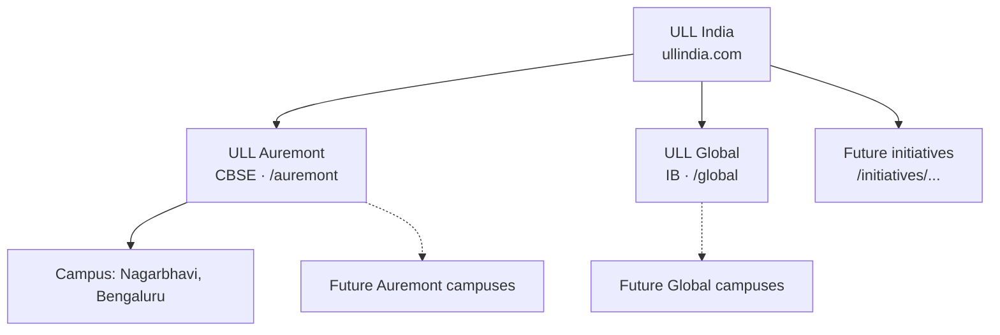

# 05 · Brand architecture

## Today

| Level | Name | Curriculum | Physical presence |
|---|---|---|---|
| Group (umbrella) | **ULL India** (United Learning League, "Inspiring Generations") | – | – |
| School brand | **ULL Auremont** | CBSE, Nursery – Grade 10 | **ULL Auremont School, Nagarbhavi, Bengaluru, Karnataka** (only campus today) |
| School brand | **ULL Global** | IB | none yet |
| Future | other initiatives (preschool, sports academy, aptitude/career services, teacher academy) | – | – |

The logo lockup in `content/brand/ull-logo-lockup.jpg` already shows "ULL Global · ULL Auremont". Brand colours from `PLAN.md` 2a: navy primary for all, **orange accent for Auremont**, **teal accent for Global**, gold for rules and badges.

## Model: brand → campus



A **brand** is what parents choose (curriculum, philosophy). A **campus** is where the child goes. Leads, visits, staff and students belong to a campus; content belongs to a brand and optionally a campus.

## URL structure

**Recommendation: subfolders, not subdomains.**

| Option | Pros | Cons |
|---|---|---|
| Subfolders `ullindia.com/auremont`, `/global` | One domain authority for SEO, one sitemap, one certificate, one login cookie, simpler analytics | – |
| Subdomains `auremont.ullindia.com` | Feels separate | Google treats each as its own site; splits authority; extra certs, cookies and analytics config |

Competitors: VIBGYOR uses paths (`/school/{city}/{board}/{campus}`), Orchids uses paths (`/{city}-branches/{campus}`), Ryan mixes paths, subdomains and separate domains. The mixed approach is the one to avoid (see plan 15).

Final URL map:

```
ullindia.com/                         ULL India group home
ullindia.com/about, /leadership, /careers, /news, /contact
ullindia.com/auremont/                ULL Auremont brand home
ullindia.com/auremont/nagarbhavi/     campus page (address, map, transport, fees, visit)
ullindia.com/auremont/academics/...   brand-level content
ullindia.com/auremont/admissions/
ullindia.com/global/                  ULL Global brand home
ullindia.com/global/ib-programme/...
ullindia.com/global/interest/         waitlist until a campus opens
ullindia.com/initiatives/<name>/      future
auremont.ullindia.com  → 301 → ullindia.com/auremont/
global.ullindia.com    → 301 → ullindia.com/global/
```

The current site is built at the root (e.g. `/academics/foundational`). Move it under `/auremont/` with 301 redirects from the old paths (redirects managed in CMS, plan 07).

## CMS and data changes

New collections:

| Collection | Key fields |
|---|---|
| `brands` | name, slug (`auremont`, `global`), curriculum, tagline, accent colour, logo, legal entity (plan 03), social links, status (`live`, `launching`, `planned`) |
| `campuses` | brand, name, slug (`nagarbhavi`), address, geo, phone, WhatsApp number, email, grades offered, affiliation no., Google Business Profile id (plan 12), visiting hours, status |

Relations added to existing collections:
- `pages.brand` (optional = group page) and `pages.campus` (optional).
- `media.brand` for filtering the library.
- `enquiries.brand` + `enquiries.campus` (required; the form sets it from the page it is on).
- `users.campuses` (many) so a School admin, counsellor or front desk only sees their campus (update `cms/src/access/roles.ts` with row-level filters).

Site settings move from one global to per-brand values: header CTA labels, phone, WhatsApp, footer.

## Visual rules

- Group pages: navy + gold, ULL India lockup.
- Auremont pages: navy + **orange** accent, Auremont lockup, "a ULL India school" endorsement in the footer.
- Global pages: navy + **teal** accent, Global lockup, same endorsement.
- The header always shows the group switcher ("ULL India · Auremont · Global") so families can move between brands.

## How ULL Global appears before a campus exists

- Status `launching`: brand page, IB approach, leadership, "Register interest" form (creates a CRM lead with `brand=global`, `intent=waitlist`).
- No fees, no visit booking, no "admissions open" claims until IB authorisation status allows it. IB is strict about how candidate/authorised status is described; use only IB-approved wording.

## Acceptance

- Adding a third brand or second campus needs only CMS entries, no code.
- A counsellor assigned to Nagarbhavi cannot see a Global waitlist lead unless also assigned to Global.
- Old URLs redirect to `/auremont/...` with 301.

## Open questions

1. Is ULL Global's first campus planned (city, year)? Is IB candidacy started?
2. Should Auremont's campus page be `/auremont/nagarbhavi` now, even with one campus? (Recommended: yes, so a second campus needs no URL changes.)
3. Final logo files (SVG) for each lockup.
