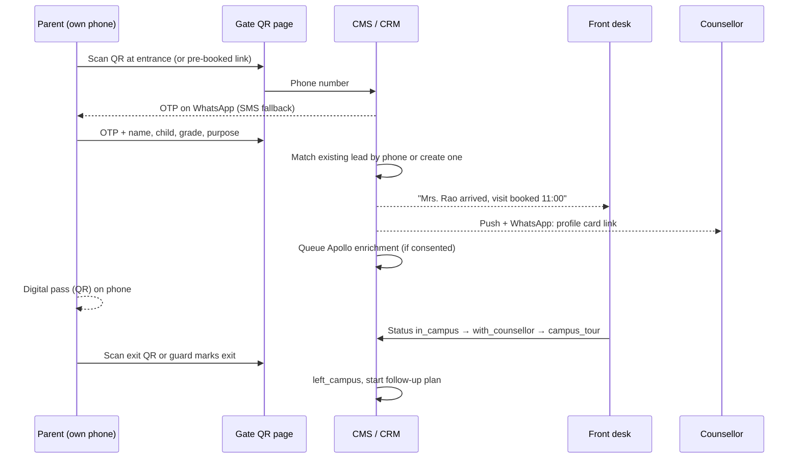

# 06 · Visitor management dashboard and operational intelligence

Reference product: Qudify's visitor management (QR check-in on the visitor's own phone, no app, WhatsApp approvals, digital passes, pre-invites, verification team, blacklist, logs, analytics, office-wise admin). We build the school version of this inside our CRM so a visit and an admission are one record.

## What exists

`cms/src/collections/Enquiries.ts` already stores `type: visit`, `preferredDate` and a `visit.passCode`, and `notify()` sends `visit_requested`, `visit_confirmed` and `visitor_arrived` templates. There is no gate page, OTP, status history or live board yet.

## A. Gate registration, alerts and parent profile

### Visitor journey

### Before arrival (pre-registration)

- Families who booked online get a WhatsApp/email message 24h and 2h before with their pass link. The pass QR encodes the visit id + pass code (already generated).
- The counsellor gets the day's schedule at 08:00 with each family's profile card.
- The front desk sees "expected today" on the board, and refreshments, a tour guide or a classroom observation slot can be prepared.

### At the gate

- One static QR poster at each entrance → `ullindia.com/visit/checkin?campus=nagarbhavi&gate=main`.
- Phone OTP: 6 digits, 5-minute expiry, 3 attempts, rate-limited by WAF (plan 02). Send by WhatsApp authentication template (cheaper, higher delivery) with Gupshup SMS fallback. OTP templates need DLT registration for SMS.
- Visit purpose: admission enquiry, scheduled visit, parent of current student, vendor, interview candidate, other. Only admission purposes create CRM leads; others are logged as visitors.
- Optional tablet kiosk mode at the front desk for families without smartphones (same page, front-desk-assisted OTP).
- Guard verification view: scan the parent's pass to confirm; blacklist check (flagged numbers alert security).

### Visit statuses

| Status | Set by | Meaning |
|---|---|---|
| `pre_registered` | Online booking | Slot booked, not arrived |
| `entered_campus` | Gate OTP success | Through the gate |
| `in_campus` | Front desk | Waiting in reception |
| `with_counsellor` | Counsellor taps "Start session" | Counselling started (starts recording, see B) |
| `campus_tour` | Counsellor / guide | Touring |
| `child_interaction` | Teacher | Child assessment / interaction |
| `left_campus` | Exit QR or guard | Visit complete |
| `no_show` | Auto at slot + 2h | Booked but did not come |
| `cancelled` | Parent / staff | Cancelled |

Each change is stored in `visits.history[]` with time and user, so we get wait time, session length and tour length per visit.

### Parent profile (operational intelligence)

Profile card shown to the counsellor before the parent sits down:

- From our data: child name and grade, source (plan 18), pages viewed on the site, previous enquiries, calls, WhatsApp chats, siblings, current school, priority stated on the form.
- From enrichment (Apollo People Enrichment API by email/phone, or LinkedIn data via a licensed provider): job title, company, industry, seniority, city, LinkedIn URL.
- Derived: likely fee comfort band, relocation flag, distance from campus (from pincode), suggested talking points (generated by Claude from the above).

**Compliance:** scraping LinkedIn directly breaches its terms, so only a licensed provider is used. Under the DPDP Act, enrichment needs a stated purpose and notice. The gate form shows: "We may use your professional details from public sources to personalise your visit" with a checkbox. No checkbox, no enrichment. Enrichment data is deleted after 12 months if the family does not enrol.

### Visitor dashboard (`/admin/visits`)

- **Live board:** columns by status, timers for waiting families (alert if waiting > 10 min with no counsellor).
- **Today:** expected vs arrived vs no-show, counsellor load.
- **Analytics:** visits per day/week, peak hours, average wait, session and tour length, visit → application conversion by counsellor and source, no-show rate.
- **Logs:** searchable list, export CSV (admin only).

## B. Recording the counselling conversation

- The counsellor wears a recorder (device choice and the full metrics are in plan 21).
- "Start session" in the CRM links the recording window to the visit. When the device syncs, the audio file is uploaded to the private documents bucket (plan 02) and matched to the visit by counsellor + time.
- Pipeline: upload → speech-to-text with speaker labels (Sarvam Saarika for Indian English, Kannada, Hindi and code-mixed speech; AWS Transcribe as fallback) → Claude analysis → stored on the visit:
  - summary, child's needs, parent's concerns (fees, transport, curriculum, safety), objections and how they were handled
  - questions the counsellor could not answer (fed back to content and training)
  - interest score, next best action, suggested follow-up message
  - counsellor quality scores (talk ratio, discovery questions asked, key points covered) for plan 21
- **Consent:** a visible notice at reception and a spoken line at the start ("This conversation is recorded to help us serve you better"). A parent who says no gets an unrecorded session; the counsellor taps "No recording". Audio is kept 180 days, transcripts 1 year, unless the family enrols and agrees otherwise.

## C. Follow-up and post-visit communication

After `left_campus`, the CRM starts a follow-up plan driven by the AI summary:

| When | Channel | Content |
|---|---|---|
| +1 hour | WhatsApp | Thank you, brochure PDF, walkthrough video, the counsellor's contact, answers to questions raised in the session |
| +1 day | Email (Gmail-quality template from SES; or Gmail API from the counsellor's mailbox if Google Workspace is used) | Personal summary, fee sheet for the grade, next steps |
| +3 days | AI voice call (Sarvam agent, plan 22) | "Do you have any questions? Shall we book the child interaction?" with handover to the counsellor |
| +7 days | SMS | Reminder of admission timeline / seats |
| Ongoing | WhatsApp broadcasts | Events, open days, achievements (brand recall), only with opt-in |
| Enrolled | WhatsApp + email | Welcome, onboarding, then upsell: transport, after-school programmes, sports academy, aptitude tests (plan 20) |

Rules: stop the sequence when the stage changes (enrolled, lost), respect quiet hours (no calls before 09:00 or after 21:00), honour opt-out on every channel, and log every message on the lead timeline.

## Data model

| Collection | Key fields |
|---|---|
| `visits` | lead, campus, purpose, slot, status, history[], pass code, gate, counsellor, guide, recording, transcript, aiSummary, scores |
| `visitors` | phone (verified), name, blacklisted, consent flags (enrichment, recording, marketing) |
| `enrichments` | visitor, provider, raw payload, fetchedAt, expiresAt |
| `followUps` | lead, step, channel, scheduledAt, sentAt, status, content |

## Build order

1. 30 Nov – 18 Dec: `visits` collection, statuses, gate page with OTP, live board (no enrichment).
2. 4 – 15 Jan: alerts, analytics, guard view, kiosk mode.
3. 11 – 22 Jan: Apollo enrichment job + profile card, consent texts.
4. 18 Jan: pilot at Nagarbhavi with the real front desk.
5. 18 Jan – 29 Jan: recording link and follow-up sequences (depends on plans 21 and 22 for devices and voice).

## Acceptance

- A parent can go from gate QR to digital pass in under 60 seconds.
- The counsellor receives an alert within 10 seconds of OTP success.
- Every admission visit has a status history and ends in `left_campus` or `no_show`.
- No enrichment or recording without a stored consent flag.

## Open questions

1. How many entrances does the Nagarbhavi campus have, and is there a guard post with a phone or tablet?
2. Does ULL use Google Workspace (Gmail API follow-ups from the counsellor's own mailbox) or Microsoft 365?
3. Apollo plan and credits budget per month?
