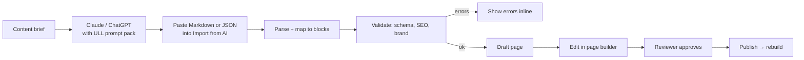

# 07 · Website with CMS, AI content and SEO validation

## What exists

- Payload CMS at `/admin` with `Pages` (title, slug, description ≤ 170, hero, breadcrumb, blocks), `Media`, `SiteSettings`.
- Blocks: `text`, `cards`, `table`, `steps`, `faq`, `quote`, `gallery`, `cta`, `subnav`, `enquiry` (`cms/src/blocks/index.ts`).
- Puck visual page builder at `/editor/` with phone/tablet/desktop preview, drafts and publish; Live Preview in Payload. Publishing triggers the static rebuild (`cms/src/lib/rebuild.ts`).
- `web/src/app/sitemap.ts` and `robots.ts`.

## 1. AI content intake

### The flow

### Two input formats

1. **Markdown (easiest for writers).** Rules in the prompt pack: one `#` title, `##` per section, a front-matter block for `slug`, `metaTitle`, `description`, `brand`. The importer maps patterns to blocks: a `##` section with prose → `text`; a list of `### Title` + paragraph → `cards`; `Q:`/`A:` pairs → `faq`; numbered steps → `steps`; a `>` quote → `quote`; a two-column table → `table`; a final "Book a visit" section → `cta`.
2. **JSON (exact).** We publish `cms/content-schema.json`, generated from the block configs, so Claude or ChatGPT (structured output / JSON mode) returns a valid `blocks` array directly.

### Prompt pack (stored in the CMS as a global, so the content lead can tune it)

- Brand voice: warm, clear, parent-first, no superlatives without proof ("best school" is banned unless an award is cited), Indian English spelling.
- Facts sheet per brand (grades, board, address, programmes) so the AI doesn't invent facts.
- Output rules: block types allowed, word limits per block, meta title 50–60 chars, description 140–160 chars.
- A "do not claim" list: fees, results, rankings, IB authorisation wording (plan 05).

### In-CMS AI actions

Buttons on fields and blocks, calling Claude through a server route (`/api/ai/*`, staff only, logged):

| Action | Where |
|---|---|
| Write meta title / description from page content | SEO tab |
| Suggest alt text from the image (vision) | Media upload |
| Generate FAQ block from the page | Blocks |
| Shorten / simplify / make friendlier | Any text field |
| Translate to Kannada / Hindi (for future language versions) | Page |
| Check facts against the brand facts sheet | Before publish |

Provider adapter: `cms/src/lib/ai.ts` with `anthropic` default (`claude-sonnet-5-5` for drafting, `claude-haiku-5-5` for quick field actions) and an `openai` option, chosen by env var. API keys live in Secrets Manager. Every call is stored in an `aiLogs` collection (user, action, tokens) for cost tracking.

## 2. SEO settings per page

Add an **SEO** tab to `Pages` (and to News, Events):

| Field | Rule |
|---|---|
| Meta title | Required, 30–60 chars, unique across the site, falls back to `title` |
| Meta description | Required, 120–160 chars (today: max 170), unique |
| Slug | lowercase, `a-z0-9-/`, no trailing slash, unique, no stop-word bloat |
| Canonical URL | Defaults to self; override for duplicates |
| Robots | index/noindex, follow/nofollow (noindex forced on thank-you, portal, preview) |
| OG image | Required 1200×630; falls back to the hero image |
| Focus keyword | Optional; checked for presence in title, H1, first paragraph and slug |
| Schema type | `WebPage`, `AboutPage`, `ContactPage`, `FAQPage`, `Article`, `Event`, `School`, `Course` |
| Breadcrumb | Already exists; drives `BreadcrumbList` JSON-LD |
| Hreflang | For future Kannada/Hindi versions |

## 3. Validations (block publish on errors, warn otherwise)

| Check | Level |
|---|---|
| Meta title and description present, lengths in range, unique | Error |
| Exactly one H1 (the hero heading); headings not skipping levels | Error |
| Every image has alt text (5–125 chars, not the filename) | Error |
| Images ≤ 400 KB after processing; hero ≤ 250 KB; WebP/AVIF sizes generated | Error |
| Internal links resolve to a published page or redirect | Error |
| No external link without `rel="noopener"`; nofollow on sponsored | Auto-fix |
| Page has at least 300 words (except utility pages) | Warning |
| Focus keyword present where set | Warning |
| Readability (sentence length, passive voice) | Warning |
| Banned claims from the prompt pack ("No.1", "best" without source) | Error |
| Phone/address match the campus record (NAP consistency) | Error |
| Enquiry/visit CTA present on brand and campus pages | Warning |
| Fact check against brand facts sheet (AI, optional) | Warning |

A sidebar panel in both `/admin` and the page builder shows a score (0–100), the list of failed checks, and "Fix with AI" where possible. Validation runs in a Payload `beforeChange` hook when `_status` goes to `published`, so it cannot be bypassed.

## 4. Site-wide SEO

- Redirects collection (from, to, 301/302) → compiled into the CloudFront function at build time; also used for the `/academics/...` → `/auremont/academics/...` move (plan 05).
- Sitemap per brand (`/sitemap.xml` index → `/auremont/sitemap.xml`, `/global/sitemap.xml`), rebuilt on publish; ping Search Console.
- JSON-LD: `Organization` (ULL India) with `subOrganization` brands, `School` per campus with address, geo, phone, `sameAs` socials; `FAQPage`, `Event`, `NewsArticle`, `BreadcrumbList`, `Person` (principal, faculty).
- Core Web Vitals budget enforced in CI with Lighthouse CI on 5 key pages: LCP < 2.5s, CLS < 0.1, INP < 200ms, performance ≥ 90.
- Custom 404 with search and CTAs; `noindex` on preview and editor.

## 5. New content types

| Collection | Why |
|---|---|
| `news` | Fresh, rankable pages; feeds Google Business Profile posts (plan 12) |
| `events` | Open days, workshops; `Event` schema; registration form → CRM |
| `faculty` | Teacher profiles build trust (competitors show achievers, not teachers) |
| `faqs` | Shared FAQ library reused across pages; FAQPage schema |
| `downloads` | Brochures, fee sheets, prospectus (gated by a short form → CRM lead) |
| `testimonials` | Parent and student quotes, video links |

## 6. Workflow and roles

- Draft → In review → Published, using Payload versions/drafts. Content editors draft; School admin or Group admin approves.
- Scheduled publish (Payload `schedulePublish`) for campaign pages.
- Audit trail: who changed what, from versions.

## 7. Cookie consent

Banner with Accept / Reject / Settings (plan 03 privacy). GA4, Google Ads and Meta Pixel load only after consent (Google Consent Mode v2). Default: reject non-essential.

## Acceptance

- A writer pastes an AI draft and gets an editable draft page in under a minute, with no developer.
- A page with a missing alt text or a 200-character description cannot be published.
- Lighthouse CI passes on the key pages.
- `/admin` shows the AI usage cost per month.

## Open questions

1. Will writers use Claude, ChatGPT, or both? (Both are supported; the prompt pack is the same.)
2. Who approves content (one approver per brand)?
3. Are Kannada pages wanted for 2027-28?
