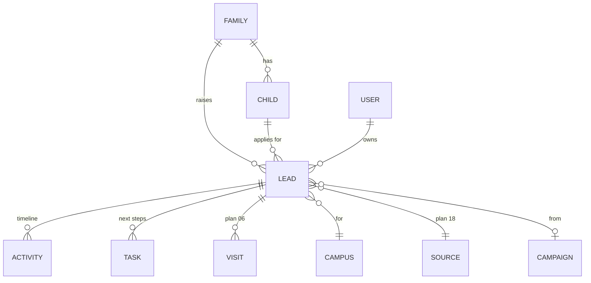

# 08 · In-house CRM at `/admin`

## Users and what they see

| Role (from `cms/src/access/roles.ts`) | Scope | Main screens |
|---|---|---|
| **Group admin** (`admin`) | All brands and campuses | Group dashboard, all pipelines, reports, users, settings, integrations |
| **School admin** (`schoolAdmin`) | Their campuses | Campus dashboard, pipeline, counsellor performance, approvals, content |
| **Admissions counsellor** (`counsellor`) | Leads assigned to them (and unassigned in their campus) | My day, my pipeline, tasks, calls, visits |
| **Front desk** (`frontDesk`) | Their campus visits | Visitor board (plan 06), walk-in entry |
| New: **Marketing** (`marketing`) | Read-only leads, full campaigns | Source and campaign reports (plan 18) |
| New: **Tele-caller** (`telecaller`) | Assigned call lists | Call queue, dispositions |

## Data model

| Collection | Key fields |
|---|---|
| `families` | primary contact (name, verified phone, email), secondary contact, address, pincode, language, consent flags, external CRM ids (plan 19) |
| `children` | family, name, DOB, gender, current school, current grade, sibling flag |
| `leads` | family, child, brand, campus, academic year, grade sought, stage, owner, score, source + attribution (plan 18), lost reason, expected join date, fee band, tags |
| `activities` | lead, type (call, WhatsApp, email, SMS, visit, note, stage change, AI call, form), direction, summary, recording link, by, at |
| `tasks` | lead, type, due at, owner, status, created by rule or user |
| `campaigns` | name, channel, budget, dates, brand, UTM campaign |

`enquiries` is migrated into `families` + `children` + `leads` (one-time migration script; the website form keeps posting to `/api/enquiries`, which becomes a thin endpoint creating a lead).

### Pipeline stages (from `STAGES` today, per campus configurable)

`New → Contacted → Visit booked → Visited → Child interaction → Documents pending → Offer made → Admission confirmed (fee paid) → Enrolled`, plus `Lost` with a required reason (fees, distance, curriculum, chose competitor (which), no response, not eligible, next year).

## Screens

1. **Counsellor "My day":** today's visits, overdue tasks, new leads to call, callbacks due; one-tap call (click-to-call via the telephony provider, plan 22) and WhatsApp (WATI).
2. **Pipeline board:** Kanban by stage with drag-and-drop, filters (campus, grade, source, owner, year, score), counts and values per column.
3. **Lead detail:** family and child card, timeline of every activity, AI summary of the latest conversation (plan 21), next best action, tasks, documents, external CRM sync status.
4. **Lists:** saved views ("Grade 1 leads not contacted in 48h").
5. **Dashboards:** see below.

Built as custom Payload admin views (React components registered in `payload.config.ts`), so they live under `/admin` with the same login and roles. Heavy lists use the Payload REST/local API with indexes on `stage`, `owner`, `campus`, `createdAt`.

## Rules and automation

| Rule | Default |
|---|---|
| Assignment | Round-robin among counsellors of the campus; by grade band if configured; Meta/Google leads to tele-callers first |
| First response SLA | Call within 15 minutes in working hours (09:00–19:00), else by 10:00 next day; escalate to School admin at 2× SLA |
| Follow-up cadence | Auto tasks after each stage change (e.g. Visited → call in 24h) |
| Duplicate handling | Same verified phone = same family; new lead for the same child + year merges into the open lead and logs the new source as a touch |
| Lead scoring | Grade fit, distance, engagement (pages, opens, replies), visit done, AI interest score; 0–100 |
| Stale leads | No activity 14 days → reminder; 45 days → move to Lost (no response) with confirmation |

## Dashboards

- **Group admin:** leads, visits, applications, admissions by brand/campus/week; source ROI (plan 18 + ad spend); funnel conversion; counsellor league table; seats filled vs target per grade.
- **School admin:** same for their campus + SLA breaches + today's visits.
- **Counsellor:** my funnel, my conversion vs campus average, calls made, response time.

## Reports and exports

Funnel by source/grade, time-in-stage, lost reasons, visit to admission, counsellor productivity. CSV export for Group/School admins only, logged.

## Security and privacy

- Row-level access by campus and owner in Payload `access` functions (not just hidden UI).
- Phone numbers masked for tele-callers except when calling through the system (optional).
- Audit log of views and exports of family records.
- Data retention: lost leads anonymised after 24 months.

## Build order

| Week | Deliverable |
|---|---|
| 9 Nov | Data model, migration from Enquiries, campus scoping |
| 16 Nov | Lead detail + timeline, tasks |
| 23 Nov | Pipeline board, assignment, SLA |
| 30 Nov | Dashboards, dedupe, CSV import/export |
| 7 Dec | Hardening, staff training, UAT with counsellors |
| 14 Dec | Live with the website |

## Acceptance

- Every website, ad and walk-in lead appears in the CRM within 1 minute with an owner.
- A counsellor sees only their campus.
- SLA breach alerts fire.
- The Group admin dashboard shows the full funnel by source for the season.

## Open questions

1. How many counsellors and tele-callers at launch?
2. Are seat targets per grade available for 2027-28?
3. Is there an existing spreadsheet of leads to import?
