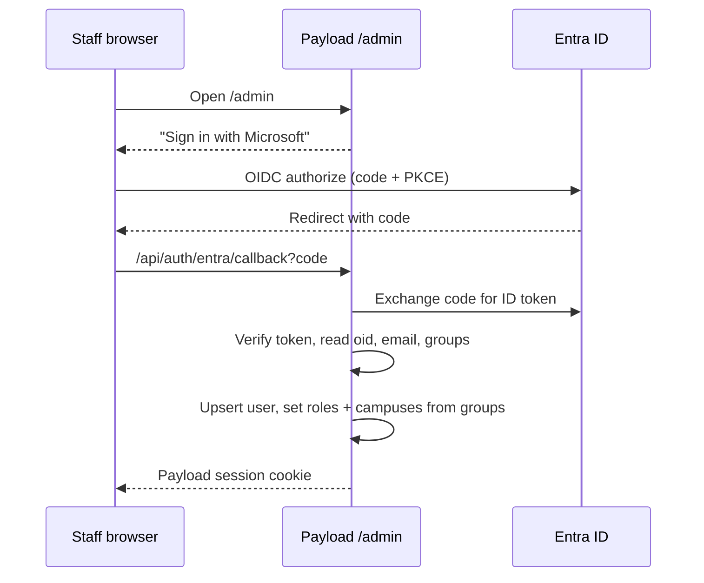

# 09 · SSO login

The user wrote "Intra ID"; this is **Microsoft Entra ID** (formerly Azure AD).

## A. Staff: Microsoft Entra ID → `/admin`

### Flow

### Setup (tenant admin, one-time)

1. App registration "ULL CMS", single-tenant.
2. Redirect URIs: `https://uat.ullindia.com/api/auth/entra/callback`, `https://ullindia.com/api/auth/entra/callback`, `http://localhost:3000/api/auth/entra/callback`.
3. Token configuration: add `groups` claim (security groups), or app roles (cleaner: roles appear as `roles` claim).
4. Groups (or app roles):

| Entra group / app role | Payload role | Campus |
|---|---|---|
| `ULL-CMS-GroupAdmin` | `admin` | all |
| `ULL-CMS-SchoolAdmin-Nagarbhavi` | `schoolAdmin` | nagarbhavi |
| `ULL-CMS-Editor` | `editor` | all |
| `ULL-CMS-Counsellor-Nagarbhavi` | `counsellor` | nagarbhavi |
| `ULL-CMS-FrontDesk-Nagarbhavi` | `frontDesk` | nagarbhavi |
| `ULL-CMS-Marketing` | `marketing` | all |

5. Conditional Access: require MFA for this app (recommended).

### Code

- `cms/src/lib/auth/entra.ts`: OIDC client (`openid-client`), PKCE, state + nonce checks, token verification against Entra's JWKS.
- `Users` collection: `auth: { strategies: [entraStrategy], disableLocalStrategy: false }` during migration; set `disableLocalStrategy: true` later except for the break-glass account.
- Roles and campuses are **overwritten from Entra on every login**, so removing someone from a group removes access at next login. A nightly job (Microsoft Graph, `GroupMember.Read.All`) deactivates users who were removed or disabled, so access ends even if they never log in again.
- Secrets (`ENTRA_TENANT_ID`, `ENTRA_CLIENT_ID`, `ENTRA_CLIENT_SECRET`) in Secrets Manager.
- Login page: Payload's admin login gets a "Sign in with Microsoft" button (custom `beforeLogin` component).

### If staff use Google Workspace instead

Same OIDC strategy with Google as issuer; groups via Cloud Identity. Decide once the domain email setup is known (plan 02).

## B. Parents and students → dashboards

### Recommendation

A separate Payload auth collection `portalUsers`, so families never share a table or cookie with staff.

| Method | Who | Notes |
|---|---|---|
| **Phone OTP** (primary) | Parents | Same OTP service as the visitor gate (plan 06): WhatsApp first, SMS fallback. Phone is already the key in the CRM, so a parent who enquired is recognised at first login |
| Google sign-in | Parents, students 13+ with school Google accounts | OIDC; email must match a family contact or be invited |
| Microsoft sign-in | Students, if the school issues Microsoft 365 student accounts | Same Entra tenant, a different app/group |
| Email magic link | Fallback | For NRI parents without an Indian number |

### Family identity model

- `portalUsers`: id, type (`parent`, `student`), phone (verified), email, linked `family`, linked `child` (for students), consent records.
- A parent sees all children in their family (plan 11). A second parent is invited by the first, or added by the school.
- **Students:** under 13 the dashboard is opened through the parent's login ("Switch to Aarav's view"); 13+ get their own login, invited by the parent or the school. DPDP rules on children's data need verifiable parental consent, which the parent gives when activating the student account.
- Sessions: 30 days for parents on trusted devices, 12 hours for students; refresh on activity.

### Hand-off to `ullindia.aptitudetest.in` (plan 20)

When a student or parent clicks "Take test" or "View report", we send them to aptitudetest.in already signed in. Options, decided by their integration docs:
1. **OIDC:** ULL acts as an identity provider (Payload issues ID tokens; needs a small OIDC provider such as `oidc-provider`).
2. **Signed JWT launch link** (likely simplest): `https://ullindia.aptitudetest.in/sso?token=<JWT>` signed with a shared secret or our private key, 2-minute expiry, containing ULL student id, name, grade, parent email/phone.
3. **SAML:** only if they require it.

## Security checklist

- PKCE + state + nonce on every OIDC flow.
- Cookies: `HttpOnly`, `Secure`, `SameSite=Lax`, scoped to `ullindia.com`.
- OTP: 6 digits, 5-minute expiry, 3 attempts, rate limit per phone and IP (WAF, plan 02).
- Login audit log (who, when, IP, method) for staff and families.
- Break-glass admin: one local account, password in a vault, alert when used.

## Acceptance

- A counsellor added to the Nagarbhavi counsellor group in Entra can sign in and sees only Nagarbhavi leads; removed from the group, they lose access within 24 hours.
- A parent who enquired with their phone signs in with OTP and sees their child.
- A student is sent to aptitudetest.in without a second login.

## Open questions

1. Is ULL on Microsoft 365 (Entra ID tenant exists) and who is the tenant admin?
2. Do students get school email accounts (Google or Microsoft)?
3. Will aptitudetest.in accept OIDC, a signed JWT, or SAML?
