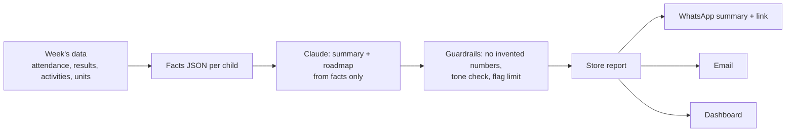

# 11 · Parent dashboard

URL: `ullindia.com/portal` (phone OTP login, plan 09). One login per parent; both parents can have their own.

## Two modes, one portal

| Family state | What they see |
|---|---|
| **Prospective** (lead in CRM) | Application status by child (stage from plan 08), documents to upload, visit booking and pass (plan 06), messages, psychometric test invites (plan 20), brochure and fee sheet |
| **Enrolled** | Everything below |

## Enrolled parent: screens

| Screen | Content |
|---|---|
| **Home** | Child switcher; this week at a glance per child: attendance, homework done, new results, teacher notes, upcoming events, fees due |
| **Progress** | The same metrics as the student dashboard (plan 10) in parent language: competency progress, scores vs the child's own trend, Holistic Progress Card, sports and participation |
| **Weekly report** | Archive of weekly reports, each with summary and roadmap |
| **Roadmap** | What's coming: units next 2–4 weeks, tests, events, and what the parent can do at home |
| **Calendar** | School calendar merged for all children; `.ics` subscribe |
| **Tests and reports** | Psychometric status and reports (plan 20) |
| **Fees** | Dues, receipts (with entity details, plan 03), pay online |
| **PTM and meetings** | Book PTM slots, counsellor sessions |
| **Messages** | Class teacher and office (moderated, school hours) |
| **Settings** | Notifications per channel, student login (13+), consents, download my data |

## Weekly progress report

### Content (per child)

1. **This week in one paragraph** (AI-written from the data, warm and specific).
2. **Highlights:** best moments (achievement, good quiz, teacher praise).
3. **Numbers:** attendance, homework on time, quizzes taken and accuracy, reading minutes; arrows vs last week.
4. **Learning:** units covered by subject, competencies that moved up.
5. **Watch:** gentle flags (missed homework twice, a dip in one subject), never more than two.
6. **Roadmap for next week:** units starting, tests, events, what to bring.
7. **Try at home:** one or two activities linked to the units.
8. **Teacher's note** (optional, if the teacher added one).

### Generation pipeline

- Runs Sunday 17:00 IST as a job (SQS worker, plan 02).
- The LLM only receives the facts JSON and must return structured output; numbers in the text are checked against the facts. If a check fails, a template version is sent instead.
- Class teachers can preview and add a note until Sunday 12:00 (optional).
- Model: `claude-sonnet-5-5`; about 1–2k tokens per child per week.

### Multiple children

One message per parent per week with a section per child (not one message per child), so siblings don't flood the parent.

## Notifications

| Event | Channel |
|---|---|
| Weekly report | WhatsApp template + email |
| Absent today | WhatsApp/SMS same morning |
| New result published | Push/WhatsApp |
| Fee due in 7 days / overdue | WhatsApp, then AI voice call (plan 22) |
| PTM slots open | WhatsApp |
| Event reminder | WhatsApp |

Push notifications: web push now (PWA, "Add to home screen"); a native app later only if usage justifies it (competitors use third-party parent apps such as MyClassboard/Hubblehox; a branded PWA avoids that cost).

## Privacy

- Parents see only children linked to their family; adding a family member requires school verification.
- Divorce/custody flags: the school can restrict one parent's access.
- Data download (DPDP right of access) as a ZIP of reports.

## Acceptance

- A parent with two children gets one weekly WhatsApp with both, opens the link and lands in the report.
- Every number in the AI text matches the dashboard.
- Prospective families can track application status without calling the school.

## Open questions

1. Weekly report send time (Sunday evening proposed)?
2. Should teachers approve each report, or only add optional notes?
3. Languages for the report (English only, or Kannada/Hindi too)?
