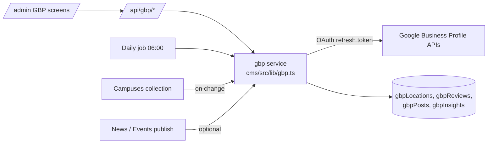

# 12 · Google Business Profile connector

## Why

For "CBSE school near me" and "school in Nagarbhavi", the Google Maps result appears above the website. Reviews, photos, posts and accurate hours drive calls and visits. Competitors list many campuses but none of the sites studied link reviews or show GBP data (plan 15).

## Before any code

1. Create or claim the profile "ULL Auremont School" at the Nagarbhavi address; category "CBSE school" (primary), "School", "Private school" (secondary). Verify by video or postcard.
2. Owner: a ULL Google account (not a personal one); managers: marketing lead.
3. Google Cloud project "ull-gbp" → request **Business Profile API** access via Google's request form. Without approval the quota is 0.
4. Enable: My Business Account Management, Business Information, Business Profile Performance, and the v4 endpoints for reviews, local posts and media.

## Architecture

- OAuth 2.0 with scope `https://www.googleapis.com/auth/business.manage`, connected once by the Group admin ("Connect Google Business Profile" button). The refresh token is stored encrypted in Secrets Manager.
- Each campus record stores its GBP `accountId` and `locationId`.

## Features

| Feature | API area | Notes |
|---|---|---|
| **Location sync** (name, address, phone, website, hours, special hours for holidays, description, attributes) | Business Information API (`locations.patch`) | Campuses collection is the source of truth; changes push automatically; Google-suggested edits shown for accept/reject |
| **Holiday hours** | Business Information `specialHours` | Filled from the academic calendar (plan 10) |
| **Reviews inbox** | v4 `accounts.locations.reviews` list + `updateReply` | New review → alert to School admin; Claude drafts a reply in the school's voice; admin edits and approves; target reply within 24h; never auto-post replies to negative reviews |
| **Review requests** | – | After enrolment or a good visit, a WhatsApp message with the review link (`g.page/r/...`), sent by the CRM (plan 08). Never offer incentives for reviews (Google policy) |
| **Posts** | v4 `localPosts` | "Publish to Google" toggle on News and Events; types: update, event (with dates), offer (open day); image from the CDN |
| **Photos** | v4 `media` | Push selected gallery albums (campus, classrooms, sports) |
| **Insights** | Business Profile Performance API (`fetchMultiDailyMetricsTimeSeries`) | Calls, direction requests, website clicks, impressions (Search/Maps, mobile/desktop), search keywords monthly |
| **Q&A** | – | Google has retired the Q&A API; handle FAQs on the website and in posts instead |

## Admin screens

- **Overview:** rating, review count, new reviews, reply time, last 28 days of calls/directions/website clicks vs previous period.
- **Reviews:** list with filters (rating, replied/unreplied), AI draft, approve.
- **Posts:** scheduled and published posts, quick create.
- **Profile:** diff between CMS and Google, sync status, last push.

## Data model

`gbpLocations` (campus, ids, last sync), `gbpReviews` (reviewId, rating, text, reviewer, createdAt, reply, repliedBy, status), `gbpPosts` (source doc, type, status, Google name), `gbpInsights` (date, metric, value).

## Metrics (feed plan 17)

Average rating, review count growth, reply rate and median reply time, calls, direction requests, website clicks from GBP, top search keywords.

## Acceptance

- Changing campus hours in the CMS updates Google within an hour.
- A new review shows in `/admin` within a day with an AI draft reply.
- A News item can be posted to Google with one toggle.
- Insights appear on the Group admin dashboard.

## Open questions

1. Does a GBP listing already exist for the campus, and who owns it?
2. Who approves review replies (School admin or marketing)?
