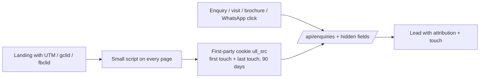

# 18 · Lead source attribution

## Source taxonomy

Four levels on every touch: **channel → source → campaign → content**.

| Channel | Sources (examples) | How it is captured |
|---|---|---|
| `paid_search` | google_ads | UTM + `gclid` |
| `paid_social` | meta, youtube, linkedin | UTM + `fbclid`; Meta Lead Ads webhook |
| `organic_search` | google, bing | Referrer, no UTM |
| `organic_social` | instagram, facebook, youtube, linkedin | UTM on bio links (`?utm_source=instagram&utm_medium=bio`) |
| `local` | google_business_profile | UTM on the GBP website link (`utm_source=gbp`) + GBP call tracking |
| `direct` | – | No referrer, no UTM |
| `referral_site` | edustoke, schoolmykids, justdial, sulekha, news sites | Referrer domain or partner UTM; directory lead emails/APIs parsed |
| `whatsapp` | click_to_chat, broadcast, inbound | Prefilled message with a ref code; WATI webhook |
| `phone` | ivr_number_<n> | One virtual number per channel (website, hoarding, newspaper); telephony webhook |
| `walk_in` | gate | Visitor desk (plan 06), source question at the gate |
| `offline` | hoarding, society_stall, preschool, pamphlet, newspaper, radio, event | Unique short link + QR per placement; coupon code |
| `referral` | parent, staff, alumni, preschool_partner | Referral code per referrer |
| `event` | open_house, workshop, sports_clinic | Event registration form |
| `email` | newsletter, nurture | UTM on every email link |
| `ai_voice` | sarvam_inbound, sarvam_outbound | Plan 22 |

UTM rules: lowercase, underscores, `utm_campaign=<brand>_<yyyymm>_<name>` (e.g. `auremont_202612_admissions_open`). A UTM builder in `/admin` creates links so nobody types them by hand.

## Website capture

Fields sent with every form: `utm_source`, `utm_medium`, `utm_campaign`, `utm_content`, `utm_term`, `gclid`, `fbclid`, `referrer`, `landing_page`, `first_visit_at`, `page_url`, plus first-touch copies of the same. The cookie is first-party and set only after analytics consent; without consent we still store the UTM of the current visit on the form (that is the user's own action, not tracking).

The current `Enquiries` field `source` becomes a group `attribution` with first touch, last touch and `touches[]`.

## Connectors

| Connector | Endpoint | Notes |
|---|---|---|
| Meta Lead Ads | `/api/hooks/meta-leads` | Subscribe the page to `leadgen` webhooks; fetch the lead by id with the system user token; map form fields; source = paid_social/meta with campaign, ad set, ad ids |
| Google Ads lead form assets | `/api/hooks/google-leads` | Webhook URL + key configured in Google Ads; includes `gcl_id`, campaign id |
| WATI (WhatsApp) | `/api/hooks/wati` | Inbound message from an unknown number → new lead; the prefilled text "Hi, I'm interested in admissions [ref: HRD-NGB-07]" sets the source; known number → touch on the existing lead |
| Telephony (Exotel / Knowlarity / Ozonetel) | `/api/hooks/calls` | Virtual number dialled → source; call recording link stored |
| Directories (Edustoke etc.) | Email parser (SES inbound → S3 → Lambda) or partner API | Source = referral_site/<name> |
| Sarvam AI | `/api/hooks/sarvam` | Plan 22 |

All webhooks verify signatures, are idempotent (dedupe by provider event id) and go through the SQS queue (plan 02).

## Offline: QR, short links and coupons

- `/admin/campaigns/links`: create a placement (e.g. "Hoarding, Nagarbhavi Circle, Dec 2026"), get a short link `ullindia.com/go/ngb-circle` and a printable QR (SVG/PNG). The short link redirects to the landing page with UTMs and logs the scan (count, time, device).
- Coupon codes: `/admin/campaigns/coupons` with code, campaign, benefit (e.g. waived registration fee, early-bird), validity, max uses. Entered on the enquiry form ("Have a code?") or by the counsellor. Redemption tracked against the lead and the admission.
- Referral codes: one per enrolled family/staff/partner preschool, auto-generated; referral reward tracked on admission.
- Printed brochures and pamphlets each carry a placement-specific QR.

## Attribution rules

- **First touch** = how the family first found us (marketing credit for awareness).
- **Last touch before lead** = what converted them into a lead.
- **All touches** kept on the timeline (e.g. Instagram → Google search → walk-in).
- Reports show first and last touch side by side; a simple position-based model (40/20/40) later if wanted.
- A walk-in who first came through a hoarding QR keeps the hoarding as first touch; the gate question "How did you hear about us?" is stored as a self-reported touch.
- Duplicate leads (same phone) add a touch, not a new lead (plan 08).
- Offline conversions upload: visits and admissions are sent back to Google Ads (by `gclid`) and Meta (Conversions API, hashed phone/email) so the ad platforms optimise for real visits, not form fills.

## Reports

- Leads, visits, applications, admissions by channel / source / campaign / placement, first vs last touch.
- Cost per lead / visit / admission where spend is known (ad APIs, plan 14; offline spend entered per campaign).
- Coupon and referral performance.
- "Unknown source" share (target < 5%).

## Acceptance

- A test lead from each channel in the table lands in the CRM with the right channel and source.
- A QR scan, a coupon and a referral code each show up on the lead.
- Visits and admissions flow back to Google Ads and Meta.

## Open questions

1. Which telephony provider (or existing numbers) does the school use today?
2. Which school directories does ULL list on, and do they send leads by email or API?
3. Coupon benefits allowed for 2027-28?
