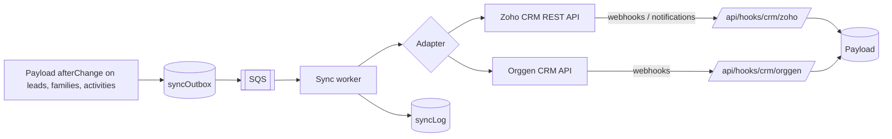

# 19 · External CRM sync

## Principle

```
Website / ads / WhatsApp / walk-in  ──►  ULL database (Payload + Postgres)  ──►  External CRM
                                         system of record                       mirror for communication
```

- Our database is written first, always. If the external CRM is down, nothing is lost; the outbox retries.
- Each field has one owner. Conflicts are resolved by ownership, not by "last write wins".

## Field ownership

| Field | Owner | Direction |
|---|---|---|
| Family, child, contact details, consent | ULL | → external |
| Brand, campus, grade, academic year | ULL | → external |
| Source and attribution (plan 18) | ULL | → external |
| Stage | ULL | → external (external stage changes come back as a *suggestion* activity, or are accepted if configured) |
| Owner (counsellor) | ULL | → external (mapped to external user) |
| Activities: calls, WhatsApp, visits, AI summaries | ULL | → external as notes/tasks |
| Call disposition / campaign membership from the external CRM | External | ← back as activities |
| External record id | External | ← stored on the family/lead |

## Architecture



- `syncOutbox(entity, entityId, op, payloadHash, target, attempts, nextAttemptAt, status)`.
- Retries with backoff: 1 min, 5 min, 30 min, 2 h, 12 h, then dead-letter with an alert to the tech owner.
- Idempotent upsert keyed by our id (stored in a custom external field `ull_id`) and the verified phone number.
- Rate limiting per provider (Zoho API credits per day depend on the edition).
- A **Sync status** badge on each lead (synced, pending, failed + retry button).

## Adapter interface

```ts
interface CrmAdapter {
  upsertContact(family: Family): Promise<ExternalRef>
  upsertLead(lead: Lead, contact: ExternalRef): Promise<ExternalRef>
  addActivity(activity: Activity, lead: ExternalRef): Promise<ExternalRef>
  updateStage(lead: ExternalRef, stage: string): Promise<void>
  parseWebhook(req: Request): Promise<InboundChange[]>
}
```

### Zoho CRM

- OAuth 2.0 server-based app (India data centre `accounts.zoho.in`, API `www.zohoapis.in`), refresh token in Secrets Manager.
- Modules: Contacts (parent), Leads or Deals (admission per child per year), Notes / Tasks / Calls (activities). Recommended: **Contacts + Deals**, with the Deal pipeline mirroring our stages.
- Custom fields: `ull_id`, `brand`, `campus`, `grade`, `academic_year`, `first_touch_source`, `last_touch_source`, `utm_campaign`, `coupon_code`.
- Upsert API with duplicate check on `ull_id` then `Phone`.
- Inbound: Zoho workflow rules → webhook to `/api/hooks/crm/zoho` (signed with a shared secret in a header), or Notification API.

### Orggen CRM

- API surface, auth and webhook support to be confirmed from Orggen's documentation (not public to us yet).
- Same interface; if Orggen has no upsert, the adapter does search-by-phone then create/update.
- If Orggen has no webhooks, poll changed records every 10 minutes.

## Mapping screen (`/admin/integrations/crm`)

- Enable per CRM and per campus.
- Stage mapping table (our stage → their stage/pipeline).
- User mapping (counsellor email → external user id).
- Field mapping with test ("send a sample lead to sandbox").
- Last 100 sync events with payloads (PII masked).

## Privacy

- Only send what the external CRM needs; children's data minimised (name, grade, DOB optional).
- Consent flags travel with the contact; marketing opt-outs must be honoured there too.
- A data processing agreement with the CRM vendor (DPDP).
- Deleting/anonymising a family in ULL triggers deletion in the external CRM.

## Acceptance

- A new website lead appears in the external CRM within 1 minute.
- Stopping the external API for an hour loses nothing; all changes catch up.
- A disposition set in the external CRM appears on the ULL timeline.
- Sync failure rate < 0.5% (plan 17).

## Open questions

1. Orggen or Zoho first? Is one already in use with existing data?
2. Zoho edition (affects API credits and custom modules)?
3. Should external stage changes be accepted automatically?
