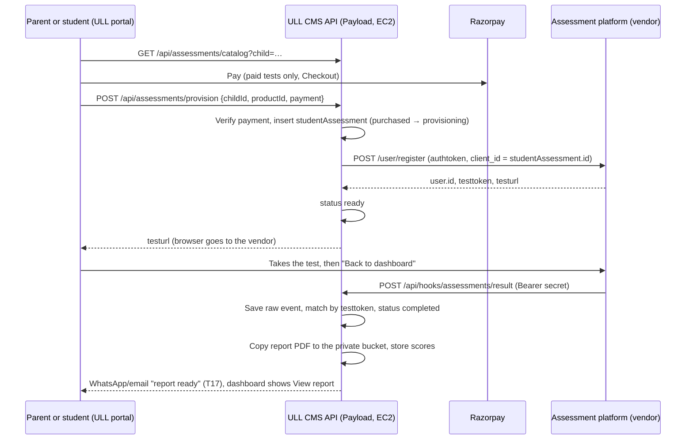

# 20 · Assessment platform integration

## What changed from the first draft

The first version of this plan assumed a branded subdomain (`ullindia.aptitudetest.in`) and SSO from the ULL portal. The vendor platform does not need either. It is already integrated with The Career Hub (Brainwonders), and that integration shows the contract:

- We **register an attempt** through their API and get back a `testtoken` and a `testurl`.
- The student opens `testurl` on the vendor's site. Their header and footer show **our** logo, colours, test name and a "back to dashboard" link, all set by us on each register call (OEM block).
- When the test is finished, the vendor **POSTs the result to our webhook** with the same `testtoken`, the report URL/PDF and the scores.

So there is no SSO handoff (plan 09's `aptitude-sso` item is dropped) and no subdomain to set up. We reuse the Career Hub design, adapted to ULL's data model, and do **not** integrate Career Hub itself.

The browser never calls the vendor. Only the CMS server holds the vendor credentials.

## Who uses it

| User | What they do |
|---|---|
| Enrolled student (13+, own login, plan 09) | Sees tests for their grade, starts them, sees status and a plain-language summary |
| Parent | Starts tests for each child (all children under 13), pays for paid tests, sees full reports and books a counsellor session |
| Applicant family (not enrolled) | Takes a free or paid test as a lead magnet from the website; becomes a CRM lead (plan 18) |
| Counsellor | Sees completed reports on the student's or lead's timeline (plan 08) |
| Group admin / IT | Fixes failed setups and unmatched results on the ops page |

## ULL vs Career Hub: the differences that matter

| Topic | Career Hub | ULL |
|---|---|---|
| Who is the "student" | A `user` with their own email | A **child** record under a parent account (plan 08 Children, plan 09 portalUsers). Young children have no email. |
| Vendor uniqueness | `uniquefactor` = email | Email alone **breaks for siblings**: two children of one parent would get the same `testtoken`. See "Child identity" below. |
| Catalog | Hard-coded `testCatalogMap.js` + JSON env override | `assessmentProducts` collection in /admin, so the Group admin adds a test without a deploy |
| Price | Fixed per product | Depends on audience: free for enrolled students, paid or free lead magnet for applicants (decision below) |
| Back-to-dashboard link | One URL | `https://ullindia.com/portal/student/` or `/portal/parent/?child=…` depending on who started the test |
| OEM branding | The Career Hub | The brand of the child's campus: ULL Auremont today (logo from the CDN, navy `#0D3161`, orange CTA `#EB5026`), ULL Global later |
| Report storage | Vendor URL only | Vendor URL **and** a copy of the PDF in the private bucket (plan 13), served by signed URL, so reports survive if the vendor link expires |
| Scores into | Pathway / co-pilot | Student dashboard psychometric summary (plan 10), parent weekly report (plan 11), counsellor timeline (plan 08), metrics (plan 17) |
| Host | Lambda + Mongo | Payload CMS on EC2 + Postgres; slow work on the SQS worker (plan 02) |

### Child identity (blocking decision)

The vendor recognises a person by `uniquefactor`, which Career Hub sets to the email. A parent with two children at ULL would register both with the parent's email, and the vendor would return the first child's `testtoken` for the second child.

1. **Preferred:** ask the vendor to accept `uniquefactor.field = "client_id"` (or a dedicated `external_id`) so uniqueness is per ULL child. We send a stable child key, `ull-child-<childId>`.
2. **Fallback:** send a per-child alias email that ULL controls, `c<childId>@students.ullindia.com`, and ask the vendor to turn off emails to the test-taker for our organisation (reports reach parents through ULL). No mailbox is needed. The parent's real email and phone stay in ULL.
3. Students 13+ with their own email still use the child key, so that a later change of email does not create a second identity.

We send only `username` (child's name), `emailid` (as above), `contact_no` (the parent's mobile). Grade, school and ULL ids stay in ULL.

## Data model (Payload)

| Collection | Key fields |
|---|---|
| `assessmentProducts` | title (card title and OEM `test_name`), slug, description, duration (minutes), vendor `examId`, `setId`, audience (`enrolled`, `applicant`, `public`), grades (multi), price for enrolled / for applicants (₹, 0 = free), GST treatment (plan 03), report includes (text), brand(s), active, sort order |
| `studentAssessments` | child, startedBy (portal user), product, status, paymentId / orderId / signature, amountPaid, `clientId` (= own id), `userVendorId`, `testtoken` (unique), `testurl` (owner-only), examId, setId, report url, report pdf url, `reportFile` (PrivateFiles, kind `report`), scores (JSON), examDate, completedAt, `vendorReturnedExistingAttempt`, `duplicateOf`, lastError, attempts (array: at, http status, message) |
| `assessmentEvents` | raw body (JSON), testtoken, examEndDate, status (`matched`, `unmatched`, `ignored`, `duplicate`, `failed`), studentAssessment, receivedAt; unique (testtoken, examEndDate) |

Statuses: `purchased` → `provisioning` → `ready` → `completed`, plus `provisioning_failed` and `result_overdue` (admin-only; the family still sees Ready).

Idempotency: unique (child, product, paymentId). Free tests use `paymentId = free:<childId>:<productId>`, so each child gets one free attempt per product.

## API (Payload custom endpoints, behind CloudFront `/api/*`)

| Endpoint | Who | Does |
|---|---|---|
| `GET /api/assessments/catalog?child=` | Anyone; personalised when signed in | Active products for that child's grade and audience, with price and that child's status |
| `GET /api/assessments/mine?child=` | Parent of the child, or the student | Enrollments with status, `testurl` (only when ready), report links |
| `POST /api/payments/assessment-order` | Signed-in parent | Creates a Razorpay order for the product price (server decides the amount) |
| `POST /api/assessments/provision` | Parent or student | Verifies the Razorpay signature and that the capture equals the price; inserts the enrollment; calls the vendor; returns `testurl` |
| `POST /api/assessments/:id/retry` | Owner or admin | Repeats register with the same `client_id` after `provisioning_failed` |
| `POST /api/hooks/assessments/result` | Vendor | Webhook (below) |
| `POST /api/assessments/events/:id/reingest`, `POST /api/assessments/attach-report` | Group admin | Ops fixes |

Access rules: a parent sees only their own children's rows; a student only their own; counsellors only their campus (plan 05 scoping). `testurl` and report links never appear in admin list JSON.

## Vendor exchanges (same contract as Career Hub)

### We call them: create or reuse an attempt

`POST {TEST_MNG_BASE_URL}/user/register`, header `authtoken: <TEST_MNG_AUTH_TOKEN>`. Body: `admin` (ULL's own admin, organization, superadmin and associate ids), `exam` (`exam_id`, `set_id` from the product), `user` (`username`, `emailid`, `contact_no`), `client_id` (= studentAssessment id), `oem` (header logo/name/colours, footer copyright and test name, `links.backtodashboard`), `uniquefactor` (see Child identity). Never send `id` or `client_log`.

| Their response | ULL does |
|---|---|
| 200 with `user.id`, `testtoken`, `testurl` | Store them, status `ready`, send the browser to `testurl` |
| 200 but the token is already on another enrollment | Flag `vendorReturnedExistingAttempt`, link `duplicateOf`, keep the payment, tell the family no new attempt was created |
| 200 missing any of the four fields | Treat as failed |
| 400, or 500 "Invalid parameters in the input fields" | `provisioning_failed`, no automatic retry |
| 401 | `provisioning_failed`, alert IT (token wrong) |
| 500 "Error in API", other 5xx, timeout | Retry up to 3 times (15 s timeout; 300 ms then 900 ms back-off), then `provisioning_failed` |
| No email/child key available | Never call; 400 to the browser |

A failed setup never refunds automatically; the family sees "We could not set up this test" with Try again, and IT sees it on the ops page.

### They call us: result

`POST https://ullindia.com/api/hooks/assessments/result`, `Authorization: Bearer <TEST_WEBHOOK_SECRET>`.

1. Wrong or missing Bearer → 401. Body without `exam` or a non-empty `testtoken` → 400.
2. Insert the raw event keyed by (`testtoken`, `exam.exam_end_date`). A repeat of that pair → 200, nothing else.
3. Match: `testtoken` → `client_id` → vendor `user_id` + `exam_id` + `set_id`. No match → event `unmatched`, alert admins, 200.
4. `exam.exam_status === 2` → copy `report.url`, `report.pdf`, `user_exam_score` and dates (store UTC, show Asia/Kolkata), status `completed`, queue a job to copy the PDF into the private bucket, send T17 to the parent (and the student if 13+). Any other status → event `ignored`, family still sees Ready.
5. Already completed and the new `exam_end_date` is missing or not newer → event `duplicate`.
6. Errors after the raw event is saved still return 200 (event `failed`) so the vendor does not retry forever. Only a failure to save the raw event returns 500.

Infra checks: CloudFront's `/api/*` behaviour must forward the `Authorization` header and must not cache POSTs (plan 02); the WAF rate limit (plan 02) must not block the vendor's webhook.

### Overdue

Hourly job (Payload jobs queue or the SQS worker): `ready` for more than 24 hours → `result_overdue` for admins only.

## What the dashboards show

- **Student dashboard** (plan 10), "Tests" tile: cards for each product for the student's grade with status (Start · Continue · Completed · View report). Scores appear as a plain-language summary, never as a label (for example no "IQ 92" on screen).
- **Parent dashboard** (plan 11): the same per child, plus Pay for paid tests, full PDF, and "Book a counsellor session to discuss".
- **Counsellor** (plan 08): completed reports and scores on the student's or lead's timeline.
- **Website** (`/auremont/…` pages, later a public `/assessments/` page): product cards for applicant families; Start sends them to sign up, then to the parent dashboard.

## Which tests ULL lists

The vendor's exam/set ids for ULL come with ULL's own organisation (todo `vendor-org`). Career Hub's ids (114/91, 115/92) belong to Career Hub's organisation and its card titles are swapped there; do not reuse either.

| Test | Audience | Notes |
|---|---|---|
| Stream selector | Grades 9–10 | Science / Commerce / Humanities guidance before Grade 11 |
| Ideal career test (aptitude, interest, personality) | Grades 8–10 | ~45 minutes; core of counselling in the Summit Pathway |
| Learning style | Grades 1–10 (parent-led under 8) | Good for parents of younger children |
| Interest | Grades 8–10 | Career clusters |
| Aptitude | Grades 8–10 | |
| IQ | Only with a counsellor | Present carefully; never as a label |
| MMPI | Not listed | Clinical inventory for adults and older adolescents; only with a qualified psychologist, not a school product |
| DMIT | Not listed | Fingerprint-based tests lack scientific support; not offered under the ULL brand unless leadership decides otherwise |

## Configuration (CMS server, AWS Secrets Manager)

| Name | Used for |
|---|---|
| `TEST_MNG_BASE_URL` | Vendor origin for `/user/register` |
| `TEST_MNG_AUTH_TOKEN` | `authtoken` header |
| `TEST_MNG_ADMIN_ID`, `TEST_MNG_ORGANIZATION_ID`, `TEST_MNG_SUPERADMIN_ID`, `TEST_MNG_ASSOCIATE_ID` | `admin` block (ULL's own organisation) |
| `TEST_WEBHOOK_SECRET` | Bearer we expect on the result webhook |
| `RAZORPAY_KEY_ID`, `RAZORPAY_KEY_SECRET` | Paid tests (plan 03) |

Exam/set ids and OEM logo/colours live on the product and brand records, not in env. Production boot fails if a required secret is missing.

## Coverage checklist

Legend: ✅ covered in this plan · 🟡 depends on the vendor · ❌ out of scope

| # | Item | Status | Notes |
|---|---|---|---|
| 1 | Test hosted and branded as ULL (OEM per register call) | ✅ | No subdomain needed |
| 2 | No second login | ✅ | `testurl` is a direct attempt link; no SSO |
| 3 | Per-child identity for siblings | 🟡 | Needs vendor agreement (child identity) |
| 4 | Catalog per grade, editable in /admin | ✅ | `assessmentProducts` |
| 5 | Start and resume from dashboards | ✅ | Same `testurl` until completed |
| 6 | Result webhook with report and scores | ✅ | Same contract as Career Hub |
| 7 | Report PDF copied to ULL private storage | ✅ | When `report.pdf` is non-empty; else link only |
| 8 | Report-ready notification | ✅ | Template T17 (setup guide) |
| 9 | Paid tests through Razorpay | ✅ | Plan 03 |
| 10 | CRM lead for applicant families | ✅ | Plan 18 source `aptitudetest` |
| 11 | Counsellor view | ✅ | Plan 08 |
| 12 | Parental consent before a minor takes a test | ✅ | Captured in ULL before provision (plan 09, DPDP) |
| 13 | Bulk invite a whole grade | 🟡 | Loop of register calls is possible; confirm vendor rate limits |
| 14 | Data deletion on request | 🟡 | Needs a vendor delete process |
| 15 | Data processing agreement | ✅ | To sign with the vendor |
| 16 | "In progress" status | ❌ | Vendor sends only completed results |
| 17 | MMPI, DMIT | ❌ | Not offered (see table) |

## Acceptance

- A parent with two children starts the same test for each and gets two different attempts.
- A Grade 9 student starts a test from the dashboard, finishes it, and sees View report within minutes of the vendor's webhook; the parent gets T17 on WhatsApp.
- A paid test cannot be provisioned without a verified ₹ capture equal to the product price; a double click creates one enrollment.
- A webhook with a bad secret gets 401; a repeated webhook changes nothing; an unknown `testtoken` appears on the ops page.
- An applicant family taking a free test appears in the CRM with source `aptitudetest`.

## Open questions

1. Will the vendor support a per-child `uniquefactor` (or turn off test-taker emails for the alias fallback)?
2. When will ULL's organisation ids, auth token and exam/set ids be issued? Is there a sandbox?
3. Which tests are free for enrolled students, and which are paid for applicants? GST on paid tests (CA, plan 03)?
4. Does the vendor's report URL expire? (Decides whether the PDF copy is required or a backup.)
