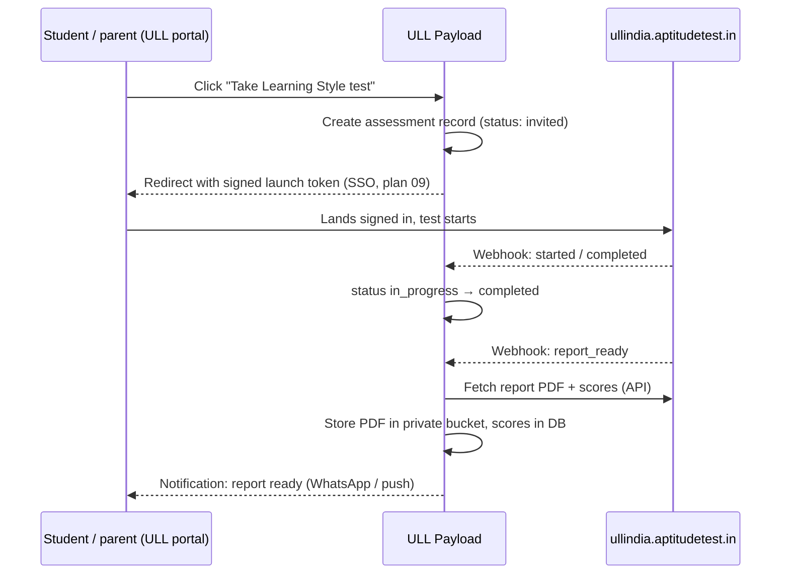

# 20 · ULL India on aptitudetest.in

## Who uses it, and why

| User | Purpose |
|---|---|
| Enrolled students (Grades 6–10 at Auremont) | Learning style, interest, aptitude, stream selector (Grade 10), career test; part of the student dashboard (plan 10) |
| Parents | See reports and counsellor recommendations (plan 11) |
| Prospective families | Free or low-cost test as a lead magnet ("Find your child's learning style"); creates a CRM lead (plan 18 source `aptitudetest`) |
| Counsellors | Use reports in counselling sessions and stream guidance |

## Tests

| Test | Typical audience | Notes |
|---|---|---|
| Aptitude | Grades 8–12 | Stream and career guidance |
| Interest | Grades 8–12 | Career clusters |
| IQ | Any | Present carefully to parents; never as a label |
| Learning style | Grades 1–10 | Good for parents of younger children |
| MMPI | Adults / older adolescents | **Clinical personality inventory; use only with a qualified psychologist and only where clinically justified. Not a school marketing tool.** Confirm age suitability with aptitudetest.in |
| DMIT | Any | **Dermatoglyphics (fingerprint-based) tests are not supported by scientific evidence.** Recommend ULL does not promote DMIT under the ULL brand, or presents it only with a clear disclaimer. Decision for ULL leadership |
| Career test | Grades 9–12 | |
| College predictor | Grades 11–12 | Limited use at Auremont (up to Grade 10) |
| Stream selector | Grade 10 | Science / Commerce / Humanities |

## Integration (subject to their docs)

### Data stored in ULL

`assessments`: child, test type, provider order id, status (`invited`, `started`, `completed`, `report_ready`, `expired`, `cancelled`), invited/started/completed dates, report file (private bucket, plan 13), key scores (JSON), counsellor notes, shared-with-parent flag.

### What the dashboards show

- Student (plan 10): tests available, in progress (resume link), completed, report summary in plain language.
- Parent (plan 11): same per child + full PDF + "Book a counsellor session to discuss".
- Counsellor (plan 08): reports on the lead/student timeline.

## Coverage checklist

Legend: ✅ covered in this plan · 🟡 depends on aptitudetest.in docs · ❌ not covered / out of scope

| # | Item | Status | Notes |
|---|---|---|---|
| 1 | Subdomain `ullindia.aptitudetest.in` set up and branded | 🟡 | Their DNS and hosting; ULL supplies logo, colours, support email/phone |
| 2 | SSL on the subdomain | 🟡 | Their wildcard cert presumably |
| 3 | SSO from ULL portal (no second login) | 🟡 | Method (JWT / OIDC / SAML) per docs; plan 09 |
| 4 | Account creation on first launch (just-in-time provisioning) | 🟡 | Needs their user API or SSO auto-provisioning |
| 5 | Test catalogue per grade, shown in ULL dashboards | ✅ | Configured in ULL CMS |
| 6 | Launch / resume test from the dashboard | 🟡 | Needs a resume URL |
| 7 | Status webhooks (started, completed, report ready) | 🟡 | Else poll their API every 15 min |
| 8 | Report PDF download into ULL private storage | 🟡 | Needs report API |
| 9 | Key scores as structured data | 🟡 | For dashboards and metrics |
| 10 | Status and reports in student dashboard | ✅ | Plan 10 |
| 11 | Status and reports in parent dashboard | ✅ | Plan 11 |
| 12 | Report-ready notification (WhatsApp/email) | ✅ | ULL `notify()` adapter |
| 13 | CRM lead for non-enrolled sign-ups with source `aptitudetest` | ✅ | Plan 18 |
| 14 | Counsellor view of reports | ✅ | Plan 08 |
| 15 | Bulk invite a whole grade | 🟡 | Needs bulk API or CSV upload on their side |
| 16 | Payments for paid tests | 🟡 | Their checkout, or ULL gateway (plan 03); decide |
| 17 | Parental consent before a minor takes a test | ✅ | Captured in ULL before launch (plan 09) |
| 18 | Data processing agreement and DPDP compliance | ✅ | To sign with aptitudetest.in |
| 19 | Data deletion when a family asks | 🟡 | Needs their delete API or a manual process |
| 20 | Reporting: tests taken, completion rate, reports viewed | ✅ | ULL side from assessment records |
| 21 | Psychologist review for MMPI | ❌ | Clinical process, outside the software |
| 22 | DMIT kit / fingerprint capture | ❌ | Hardware and scientific validity concerns; recommend not offered under ULL brand |
| 23 | Offline / paper tests | ❌ | Not planned |
| 24 | Native mobile app | ❌ | Web only |

## Acceptance

- A Grade 9 student launches a test from the ULL dashboard without a second login, completes it, and sees the report there within the time aptitudetest.in promises.
- The parent gets a WhatsApp when the report is ready.
- A prospective family taking a free test appears in the CRM with source `aptitudetest`.

## Open questions

1. When will the integration docs and sandbox be ready?
2. Which tests are free for enrolled students, and which are paid?
3. ULL's position on DMIT and MMPI.
