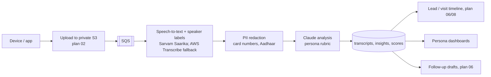

# 21 · Audio recorder devices and AI success metrics

## Devices

| Option | Example | Fits | Pros | Cons |
|---|---|---|---|---|
| **Wearable AI recorder** | Plaud NotePin / Plaud Note, similar clip-on recorders | Counsellors, sales | Small, all-day battery, one-tap, app syncs to phone; exports audio | Vendor cloud by default; we must export audio to our bucket, not rely on their transcripts |
| **Lapel mic + company phone app** | Wireless lavalier (e.g. Boya/Rode class) with a ULL recording app (PWA or simple Android app) | Counsellors, sales | Audio goes straight to our bucket; tied to the visit in the CRM | Phone must be with the person |
| **Desk / boundary mic** | USB conference mic in counselling rooms | Counselling room | Always ready, good two-person audio | Fixed location |
| **Classroom mic** | Ceiling or teacher lapel mic | Teachers (opt-in) | Lesson analysis | Many voices, children's voices = higher privacy bar |

**Recommendation:** pilot with **lapel mic + ULL recording app** for counsellors (data stays in ULL's AWS, auto-linked to the visit) and one **wearable recorder** for comparison. Desk mics in the counselling rooms. Teachers only later, opt-in, and analysing the teacher's voice track only.

Selection test (one week each): audio quality in a noisy reception, battery for a 9-hour day, sync reliability, export to S3, cost per unit, and how counsellors feel wearing it.

## Pipeline

- Linking: the app records against a visit/lead/class id; device uploads are matched by user + time window.
- Languages: English, Kannada, Hindi and code-mixed speech (Sarvam handles Indian languages well; keep a 50-recording accuracy test set).
- Analysis model: `claude-sonnet-5-5` with a rubric per persona and structured output; `claude-haiku-5-5` for quick tagging.
- Every score has quoted evidence from the transcript, so managers can check it.
- Cost tracked per recording (STT minutes + tokens).

## Consent and retention

- Parents: notice at reception + spoken line at the start; "No recording" button (plan 06).
- Staff: written policy and agreement; purpose is coaching and service quality, not covert surveillance; staff can see their own recordings and scores.
- Children: no recording of children in counselling without parental consent; classroom analysis uses the teacher's voice only.
- Retention: audio 180 days, transcripts 1 year, scores kept (no audio) for performance history. Configurable.
- Access: the person, their manager, School admin. Every playback logged.

## Success metrics per persona

### Counsellor (admissions counselling sessions)

| Metric | How AI measures it | Target |
|---|---|---|
| Discovery: asked about the child's needs, interests, current school, family priorities | Rubric checklist | ≥ 4 of 5 |
| Talk ratio (counsellor vs parent) | Speaker time | 40–60% |
| Key points covered (curriculum, safety, sports, fees, transport, next steps) | Checklist | ≥ 80% |
| Objections raised and handled (fees, distance, new school, board) | Detection + quality | Handled ≥ 80% |
| Unanswered questions | Detection | Logged → content/training |
| Clear next step agreed (interaction date, documents) | Detection | ≥ 90% |
| Tone and empathy | Rubric 1–5 | ≥ 4 |
| Session → application conversion | CRM | ≥ 50% |

### Sales (tele-callers, ground sales)

| Metric | Measure | Target |
|---|---|---|
| Opening: name, school, purpose in 15 seconds | Detection | ≥ 90% |
| Qualification (grade, area, timeline, decision-maker) | Checklist | ≥ 3 of 4 |
| Visit booking ask made | Detection | 100% of qualified calls |
| Visit booked rate | CRM | ≥ 30% of connected calls |
| Compliance: no false claims, no pressure, opt-out honoured | Detection | 100% |
| Average handle time | Duration | Track |
| Sentiment at end of call | AI | Positive/neutral ≥ 80% |

### Marketing (events, society stalls, open houses, parent interviews for content)

| Metric | Measure | Target |
|---|---|---|
| Message consistency (brand pillars mentioned correctly) | Checklist vs facts sheet | ≥ 90% |
| Parent questions and themes (top 10 per month) | Topic clustering | Feeds content plan |
| Competitor mentions (which schools, why) | Detection | Feeds plan 15 |
| Leads captured per activation with source | CRM | Plan 17 |
| Testimonial-worthy quotes found (with consent) | Detection | ≥ 5 per month |

### Teacher (opt-in, coaching only)

| Metric | Measure | Target |
|---|---|---|
| Teacher talk vs student talk time | Speaker time (teacher track + classroom mic) | Student talk ≥ 30% |
| Open questions asked | Detection | Grow over term |
| Wait time after questions | Audio gaps | ≥ 3 s |
| Lesson structure (objective stated, recap, check for understanding) | Checklist | ≥ 80% |
| Praise vs correction balance | Detection | Track |
| Use of student names / inclusive participation | Detection | Track |

Teacher scores are never used for appraisal without the academic head and staff agreeing; they are for self-reflection and coaching.

## Dashboards

- **Personal:** my sessions, scores over time, best moments, one tip per week.
- **Manager:** team averages, calibration (manager rates 5 sessions/month to check the AI), coaching queue.
- **Group admin:** top objections, unanswered questions, competitor mentions, conversion vs quality score correlation.

## Rollout

| Weeks | Step |
|---|---|
| 18 Jan – 29 Jan | Device trial, consent approved, pipeline on UAT |
| 1 Feb – 12 Feb | Counsellor pilot (Nagarbhavi), calibration |
| 15 Feb – 26 Feb | Sales and tele-callers; marketing events |
| From Apr (new year) | Teachers, opt-in |

## Acceptance

- A recorded counselling session shows a transcript, summary and scorecard on the visit within 15 minutes of upload.
- Manager and AI scores agree within 1 point (5-point scale) on ≥ 80% of calibration samples.
- No recording exists without a consent record.

## Open questions

1. How many devices in the pilot (counsellors, tele-callers)?
2. Do staff have company phones?
3. Union/staff policy considerations for teacher recordings?
