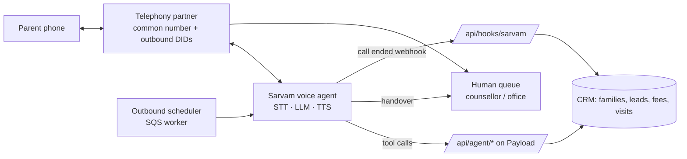

# 22 · Sarvam AI voice agents

## Why Sarvam

Sarvam's models are built for Indian languages: speech-to-text (Saarika) handles code-mixed Kannada/Hindi/English, text-to-speech (Bulbul) has Indian voices, and their conversational agent platform (Samvaad) connects to telephony. Confirm current product names, pricing and SLAs with Sarvam during setup.

## Architecture

### Tools the agent can call (server-side, authenticated, logged)

| Tool | Purpose |
|---|---|
| `lookupCaller(phone)` | Family, children, open leads, enrolled status, language preference |
| `getFeesDue(familyId)` | Amount, due date, payment link (plan 03) |
| `sendPaymentLink(familyId)` | WhatsApp/SMS the link |
| `getVisitSlots(campus, date)` / `bookVisit(...)` | Book or move a visit (plan 06) |
| `answerFaq(question)` | Retrieval over the CMS FAQ library and brand facts sheet (plan 07) |
| `createCallback(reason, time)` | Task for a human (plan 08) |
| `logOutcome(disposition, summary)` | CRM activity |
| `handover(team, summary)` | Warm transfer |
| `optOut(channel)` | Stop calls/messages |

The agent never reads out sensitive data until the caller is verified (calling from the registered number + child's name/DOB check).

## Use cases

### Outbound

| Use case | Trigger | Goal | Hand over when |
|---|---|---|---|
| **Visit reminder / confirm** | 24h before a booked visit | Confirm, reschedule, share directions | Caller wants to talk about admissions in detail |
| **New lead first call** (outside working hours) | Lead created after 19:00 or on Sunday | Qualify (grade, area, timeline), book a visit | Parent asks for a counsellor |
| **Post-visit follow-up** | +3 days after visit (plan 06) | Answer questions, book child interaction | Any objection on fees or a complaint |
| **Lead re-engagement** | No activity 14 days | Revive or close as lost with reason | Interest shown |
| **Fee collection reminder** | 7 days before due, on due date, +3, +10 days | Remind, send payment link, note promise-to-pay date | Dispute, hardship, angry caller |
| **Document reminder** | Documents pending 5 days | List missing documents, send upload link | Questions about eligibility |
| **Event invites** | Open house, workshop | RSVP | – |
| **Upsell / brand recall** | Enrolled families (opt-in) | Transport, after-school programmes, sports academy, psychometric tests (plan 20) | Interest shown |
| **Feedback survey** | After first month, after PTM | NPS + one open question | Low score → callback by School admin |

### Inbound (one common number for ULL India)

| Role | Handles |
|---|---|
| **Desk admin** | Routing by brand/campus, school timings, address and directions, holidays, transport routes, "speak to the class teacher" message taking |
| **Online counsellor** | Admissions FAQs, eligibility by age, curriculum, fee range (only what the CMS allows), book a visit, brochure on WhatsApp |
| **Parent support** | Fee status and payment link, absence reporting, PTM booking, report-ready questions |
| **After hours** | Everything above, plus callback booking for anything it can't resolve |

## Human handover

- **Warm transfer** in working hours: the agent says "I'll connect you to Ms. Priya from admissions", the telephony partner bridges the call, and the human sees a summary pop-up in the CRM (caller, intent, what was said, sentiment).
- Handover triggers: caller asks for a human, two failed understanding attempts, complaint/anger, safety or child-protection concern (immediate, to the School admin), payment dispute, anything not in the tools.
- No human free: create a callback task with an SLA of 30 minutes; tell the caller when to expect it.
- Every handover reason is tagged, so the agent can be improved.

## Compliance

- **TRAI / DLT:** register the entity, headers and templates; use the number series and registrations required for service vs promotional calls; promotional calls only to consenting numbers not on DND.
- Calling window: 09:00–21:00 IST; no calls on major holidays for non-urgent cases.
- Disclosure at the start: the caller is told it's an AI assistant from ULL and that the call is recorded.
- Consent and opt-out: "Say 'stop calling' at any time"; opt-out is stored and honoured on all channels (plan 08).
- Fee calls: polite, factual, no threats; maximum 4 attempts per due cycle.
- DPDP: purpose limitation, recordings retained 180 days (plan 21).

## Staffing effect (target)

| Function | Today (typical) | With agents |
|---|---|---|
| Front office phone | 2 people | 1 person for handovers + walk-ins |
| Tele-callers for leads | 2–3 | 1 (qualified handovers only) |
| Fee follow-up | Accounts staff calls | Agent + accounts for disputes |
| After-hours coverage | None | 24×7 |

## Metrics (feed plan 17)

| Metric | Target |
|---|---|
| Containment (resolved without a human) for inbound FAQ | ≥ 60% |
| Handover with correct summary | ≥ 95% |
| Visit reminder confirmation rate | ≥ 70% |
| Visits booked by agent per week | Track |
| Fee collected within 7 days of reminder | ≥ 60% |
| Caller satisfaction (post-call 1–5) | ≥ 4.0 |
| Average latency (turn response) | < 1.5 s |
| Opt-out rate | < 3% |
| Cost per call vs human cost | Track |

## Build order

| Weeks | Step |
|---|---|
| 1 Feb – 12 Feb | Telephony + DLT, Sarvam account, CRM tools API, test number |
| 15 Feb – 26 Feb | Visit reminders (outbound) + inbound FAQ desk (English) |
| 1 Mar – 12 Mar | Lead follow-up and post-visit calls; Kannada and Hindi |
| 15 Mar – 26 Mar | Fee reminders (ready for 2027-28 first term), handover polish, dashboards |

## Acceptance

- A parent calling the common number in Kannada gets school timings and a visit booked without a human.
- A fee reminder call sends a working payment link on WhatsApp during the call.
- A handover shows the summary to the human before they say hello.
- Every call has a CRM activity with disposition and recording link.

## Open questions

1. Existing phone numbers to keep, or new numbers?
2. Fee reminders from the start of 2027-28, or earlier for the current year?
3. Which voices (gender, accent) represent ULL best? Test with parents.
