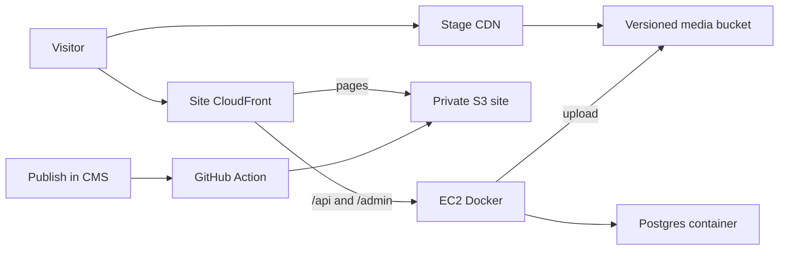

# UAT and prod, each with its own EC2 and CDN

Two stages only. UAT and prod do not share a server, database, site bucket, or media bucket. The `dev` git branch stays in the repo and is not deployed. There is no Hostzop server.

Deploys from this machine use AWS CLI profile **ull-aws-cursor-vaibhav** (IAM user `vaibhav-mac` in account `862330373376`). That profile has no default region, so every command sets **ap-south-1**. CloudFront certificates are created in **us-east-1**.

```bash
aws sts get-caller-identity --profile ull-aws-cursor-vaibhav
aws cloudformation deploy --profile ull-aws-cursor-vaibhav --region ap-south-1
```

## How one stage is served

The diagram is the same for UAT and for prod. Nothing in it is shared with the other stage.



- **Website:** `web` is a static export (`output: "export"` in [web/next.config.ts](web/next.config.ts)). [deploy/deploy-web.sh](deploy/deploy-web.sh) syncs HTML and scripts to that stage’s bucket. [deploy/cloudfront-function.js](deploy/cloudfront-function.js) maps `/path` to `/path/index.html`.
- **CMS and database:** [deploy/docker-compose.yml](deploy/docker-compose.yml) runs on a t3.medium (4 GB). The `cms` container is [cms/Dockerfile](cms/Dockerfile). The `db` container is Postgres 16. Its data volume sits on an encrypted EBS disk. Postgres is not reachable from the internet. Port 3000 accepts traffic only from CloudFront. Administration is through Systems Manager, not an open SSH port. [deploy/backup-db.sh](deploy/backup-db.sh) writes each night’s dump to that stage’s private backup bucket.
- **Brand CDN:** each stage has its own private, versioned bucket and its own CloudFront distribution. Objects are cached for one year and marked immutable, because a changed file gets a new URL.

## Versioned images and media

Payload currently writes uploads to local disk ([cms/src/collections/Media.ts](cms/src/collections/Media.ts)), including the `card` and `hero` sizes. Each stage’s CMS uses `@payloadcms/storage-s3` and writes only to that stage’s bucket. The EC2 instance role can write to its own media bucket and to no other.

Every file, including each resized size, is stored under a content hash:

- `media/3f2a9c1b/campus-hero.webp`
- `media/3f2a9c1b/campus-hero-card.webp`
- `media/3f2a9c1b/campus-hero-hero.webp`
- Brand files from `web/public/assets` use `assets/9c1b3f2a/ull-logo.webp`

Replacing a photo writes a new hash and a new URL. The previous URL keeps working until the next site build. S3 versioning is on, so an overwritten key can still be recovered. Applicant documents, when that module is built, stay off the public CDN and use signed URLs.

## Names and promotion

Main is the source of truth and is not deployed. Work merges to `main`, then `main` is merged into `uat`, then into `prod`. A push deploys only that stage.

- **uat:** `uat.ullindia.com` and `cdn-uat.ullindia.com`
- **prod:** `ullindia.com`, `www.ullindia.com`, and `cdn.ullindia.com`

[cms/src/lib/rebuild.ts](cms/src/lib/rebuild.ts) calls that stage’s `DEPLOY_HOOK_URL`, which rebuilds that stage’s site only.

CDK creates one hosted zone for `ullindia.com`, then two stacks that can be created or destroyed on their own. Each stack owns its site bucket, media bucket, backup bucket, both distributions, certificate, EC2 instance, instance role, and parameters. GitHub Actions assumes a role in this same account. The access keys behind `ull-aws-cursor-vaibhav` are not stored in GitHub.

## Cost

Two t3.medium instances in Mumbai are about $34 each. Public IPv4 is about $3.65 each, and a 30 GB encrypted disk is about $3 each. The four CloudFront distributions, three S3 buckets per stage, and the Route 53 zone add about $10–20 at low traffic. **About $90–110 per month** for UAT and prod together. SES is about $0.10 per 1,000 emails and starts in the sandbox until production access is requested.

## Before the first deploy

- Deploy with profile `ull-aws-cursor-vaibhav` and region `ap-south-1`. The profile already authenticates.
- Delegate `ullindia.com` to the new Route 53 nameservers, or point the existing DNS at the distributions. Until then, each distribution is reachable on its `*.cloudfront.net` hostname.
- Confirm SES can send from the school’s domain before relying on enquiry email.
